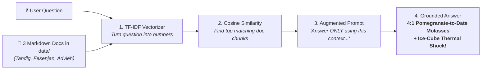
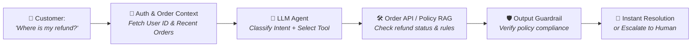
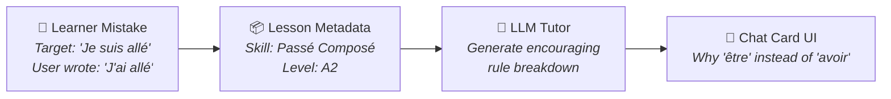
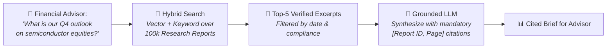

> [!NOTE] 🧭 Study Guide Overview
> This guide summarizes and explains all 4 exercises in `/Users/nooshin/Uni/Data/data6/data6/LLM`, with **comparison tables**, **architecture diagrams**, and **portfolio defense takeaways**:
> 1. **Portfolio Exercise 1 (Intro — Code Generation Benchmark):** [`1-Intro/sort/README.md`](file:///Users/nooshin/Uni/Data/data6/data6/LLM/portfolio_exercises/1-Intro/sort/README.md) (DeepSeek vs. Gemini on 10 Sorting & 10 Compression Algorithms).
> 2. **Mini Exercise 2 (Prompt Engineering & Lyra v2):** [`2-PromptEngineering/exercise_prompt_engineering.md`](file:///Users/nooshin/Uni/Data/data6/data6/LLM/mini_exercises/2-PromptEngineering/exercise_prompt_engineering.md) (The 7 Prompting Tricks & Meta-Prompting on `llama3.2`).
> 3. **Portfolio Exercise 3 (APIs, Local Ollama & RAG):** [`3-Fine-tuning-RAG-APIs-Ollama/README.md`](file:///Users/nooshin/Uni/Data/data6/data6/LLM/portfolio_exercises/3-Fine-tuning-RAG-APIs-Ollama/README.md) & [`llm.ipynb`](file:///Users/nooshin/Uni/Data/data6/data6/LLM/portfolio_exercises/3-Fine-tuning-RAG-APIs-Ollama/llm.ipynb) (Multi-LLM Saffron Culinary Assistant with TF-IDF RAG).
> 4. **Portfolio Exercise 4 (Business Use Cases):** [`4-UseCases/3_LLM_Business_Applications.pptx`](file:///Users/nooshin/Uni/Data/data6/data6/LLM/portfolio_exercises/4-UseCases/3_LLM_Business_Applications.pptx) (3 Industry LLM Applications, Business Logic Diagrams & Prompt Reconstructions).

---

# ⚡ 1. Portfolio Exercise 1: Benchmarking LLM Code Generation (`DeepSeek` vs. `Gemini`)

**Folder:** [`LLM/portfolio_exercises/1-Intro/sort/`](file:///Users/nooshin/Uni/Data/data6/data6/LLM/portfolio_exercises/1-Intro/sort/)

We asked **DeepSeek** and **Gemini** to write **10 sorting algorithms** (4 string sorts + 6 integer sorts) and **10 compression algorithms** in Python, then benchmarked them on `50,000` random items.

### 1.1. Key Takeaways from the Sorting Benchmark

| Category | Winner & Speedup | Why Did One Chatbot's Code Run Faster? (Simple Explanation) |
| :--- | :--- | :--- |
| **Radix Sorts (`MSD` & `LSD`)** | **Gemini (`2.4x – 2.8x` faster)** | DeepSeek looped over all `256` ASCII buckets even when most were empty. Gemini wrote `if buckets[b]:` to skip empty buckets and used Python's fast C-backed `list.append()`. |
| **3-Way Quick Sort & Comb Sort** | **DeepSeek (`1.1x – 1.4x` faster)** | DeepSeek partitioned elements into `less`, `equal`, `greater` inside **one single `for` loop**, whereas Gemini wrote **3 separate list comprehensions** (scanning the array 3 times per step!). |
| **Prefix Bucket Sort** | **DeepSeek (`3.75x` faster)** | DeepSeek grouped strings by first letter and used Python's built-in `sorted()` (written in C in Timsort), whereas Gemini sorted buckets using its own pure-Python `quick_sort()`. |
| **Compression on Random Strings** | **Standard Library (`zlib`/`gzip` ~75% size)** | Random strings have almost no repeated patterns. Bit-packing (`Huffman`/`zlib`) shrinks 8-bit ASCII to ~6 bits (`75%`), while dictionary methods (`LZ77`, `RLE`, `BPE`) actually **inflate** the file (`190%–483%`) because storing pointers costs more space than it saves! |

---

# 🛠️ 2. Mini Exercise 2: The 7 Prompt Engineering Tricks & "Lyra v2"

**File:** [`LLM/mini_exercises/2-PromptEngineering/exercise_prompt_engineering.md`](file:///Users/nooshin/Uni/Data/data6/data6/LLM/mini_exercises/2-PromptEngineering/exercise_prompt_engineering.md)

Tested on **`llama3.2` (3B parameters)** running locally via Ollama (`temperature=0.7, seed=42`).

### 2.1. The 7 Prompt Engineering Tricks Explained Simply

| Trick # | Trick Name | Simple Definition | Did It Work on Small Local `llama3.2` (3B)? |
| :---: | :--- | :--- | :--- |
| **1** | **Be Descriptive** | Specify audience, length limit, tone, signature, and what *not* to include. | ✅ **Worked Great:** Cut fluff in half and tailored answers to the exact target group (e.g. 15-year-olds or budget students). |
| **2** | **Give Examples (Few-Shot)** | Show 1–4 concrete `Input -> Output` examples or a style sample. | ✅ **Worked Great:** The model copied the exact pytest cases and analogy tone. |
| **3** | **Structured Text** | Use Markdown headings (`## Task`, `## Rules`) and required output tables. | ✅ **Worked Great:** Forced the model to return clean Markdown tables instead of walls of text. |
| **4** | **Chain of Thought (CoT)** | Ask the model to *"think step-by-step first"* before answering. | ⚠️ **Weak on 3B Model:** In a single prompt, the small 3B model skipped real geographic reasoning and still mixed up Paris neighborhoods. |
| **5** | **Chatbot Persona** | Give the AI a role (*"You are a senior Python developer"* or *"local Paris guide"*). | ✅ **Worked Well:** Shifted vocabulary and focus immediately. |
| **6** | **Flipped Approach** | Tell the AI to **ask you clarifying questions first** before writing the final answer. | ✅ **Essential for Meta-Prompts:** Used in Lyra's `DETAIL` mode so the AI doesn't have to guess missing context. |
| **7** | **Reflect, Review & Refine** | Ask the AI to check its own output against the rules before finishing. | ❌ **Failed inside 1 Turn:** Telling a 3B model *"check your code"* at the end of a single prompt didn't stop it from calling an undefined `merge()` function. Self-reflection requires a **second conversation turn** (feeding back the actual Python error!). |

### 2.2. Why Did "The Ultimate Prompt" (`Lyra v2`) Struggle in `BASIC` Mode?
1. **A prompt optimizer cannot invent your private requirements:** When you only give Lyra *"Plan a 3-day trip to Paris"*, Lyra doesn't know you are a budget student staying near Gare du Nord—so it guesses a *romantic trip with a 3-star hotel and Michelin restaurants*.
2. **Small models struggle with giant system prompts:** `llama3.2` (3B) couldn't even follow Lyra's own formatting rules reliably, leaving headings blank.
3. **Golden Rule:** **Better formatting $\neq$ Better truth!** Structured tables look very convincing, which hides hallucinated museum prices and broken code unless you verify them.

---

# 🍲 3. Portfolio Exercise 3: Multi-LLM APIs, Local Ollama & RAG Pipeline

**Folder:** [`portfolio_exercises/3-Fine-tuning-RAG-APIs-Ollama`](file:///Users/nooshin/Uni/Data/data6/data6/LLM/portfolio_exercises/3-Fine-tuning-RAG-APIs-Ollama/)

This project builds a **Persian Culinary AI Assistant** across 6 progressive milestones in [`llm.ipynb`](file:///Users/nooshin/Uni/Data/data6/data6/LLM/portfolio_exercises/3-Fine-tuning-RAG-APIs-Ollama/llm.ipynb) and exposes a production REST API in [`app.py`](file:///Users/nooshin/Uni/Data/data6/data6/LLM/portfolio_exercises/3-Fine-tuning-RAG-APIs-Ollama/app.py).

### 3.1. Cloud APIs vs. Local Ollama Comparison

| Provider / Model | Where It Runs | Typical Latency | Cost & Privacy | Best Use Case |
| :--- | :--- | :---: | :--- | :--- |
| **Groq (`gpt-oss-120b` / `llama-3.3-70b`)** | Cloud LPU (Language Processing Unit) | **`~0.7s – 1.0s`** (Ultra-fast) | Free tier API key; data sent to cloud. | Complex reasoning, detailed recipes, and RAG synthesis. |
| **Hugging Face (`Qwen2.5-72B`, `Llama-3.1-8B`)** | Cloud Serverless Inference API | `~1.5s – 3.0s` | Free tier token; open-weight models in cloud. | Comparing multiple open-source model families side-by-side. |
| **Local Ollama (`llama3.2` 3B)** | **100% On Your Laptop (`localhost:11434`)** | `~3.8s – 4.6s` | **100% Free & Offline Private.** | Private data, offline environments, zero API cost. |

### 3.2. How the RAG (Retrieval-Augmented Generation) Pipeline Works

Why did the baseline LLM fail when asked about *"Maman Bozorg's secret Gilani Fesenjan molasses ratio and walnut thermal shock"*?
* Because family secrets and private company documents are **not in the public training data**! Without RAG, the LLM guesses generic answers (white sugar + slow simmering).



| Stage | Without RAG (Baseline LLM) | With RAG (Grounded in `data/*.md`) |
| :--- | :--- | :--- |
| **Source of Knowledge** | Pre-trained weights from the public internet. | Retrieved text chunks from your local `data/` folder. |
| **Answer on Fesenjan Secret** | Hallucinates generic white sugar and slow simmering. | Quotes exact **4 tbsp sour pomegranate : 1 tbsp date molasses** and **2 cups ice water thermal shock**. |
| **Verifiability** | None (black box). | Cites exact source file (`['fesenjan_family_secrets.md']`). |

---

# 🏢 4. Portfolio Exercise 4: 3 Real-World LLM Business Applications

**Folder:** [`portfolio_exercises/4-UseCases`](file:///Users/nooshin/Uni/Data/data6/data6/LLM/portfolio_exercises/4-UseCases/)  
*(Companion Study Guide for [`3_LLM_Business_Applications.pptx`](file:///Users/nooshin/Uni/Data/data6/data6/LLM/portfolio_exercises/4-UseCases/3_LLM_Business_Applications.pptx) & [`img.png`](file:///Users/nooshin/Uni/Data/data6/data6/LLM/portfolio_exercises/4-UseCases/img.png))*

The assignment asks for **3 LLM applications across 3 different companies and industries**, covering for each:
1. Title & References
2. Summary of the Use Case
3. Business Logic Diagram
4. Reconstructed Key Prompt(s)
5. Application UI / Workflow

### 4.1. Summary Comparison of 3 Industry LLM Use Cases

| # | Company & Industry | LLM Application | Core Architecture Pattern | Business Impact |
| :---: | :--- | :--- | :--- | :--- |
| **1** | **Klarna** *(FinTech & E-Commerce)* | **AI Customer Service Assistant** (handles refunds, returns, disputes, and payment schedules in 35+ languages). | **RAG + Tool Calling (Function Calling)** connected to live order/payment APIs. | Handled **2.3 million conversations** (2/3 of all customer chats) in its first month; cut average resolution time from **11 minutes to <2 minutes**. |
| **2** | **Duolingo** *(EdTech / Language Learning)* | **Duolingo Max ("Explain My Answer" & "Roleplay")** (personalized grammar coach and interactive conversation partner). | **Structured Few-Shot Prompting + Pedagogical Guardrails** seeded with the learner's exact mistake and CEFR level. | Provides instant, contextual grammar explanations and open-ended cafe/travel roleplays with automated post-chat grading. |
| **3** | **Morgan Stanley** *(Wealth Management / Finance)* | **AI @ Morgan Stanley Assistant & Debrief** (searches 100,000+ internal research reports and summarizes client meetings). | **Enterprise RAG + Strict Citation Guardrails** (zero-hallucination retrieval over internal PDFs). | Adopted by **98% of financial advisor teams**; reduced research lookup from 30 minutes of reading PDFs to seconds with clickable citations. |

---

### 4.2. Business Logic Diagrams & Reconstructed Prompts for Defense

#### Use Case 1: Klarna FinTech Support Agent (RAG + Tool Calling)


* **Reconstructed System Prompt:**
  ```text
  You are Klarna's automated Customer Resolution Specialist.
  Customer Context: {user_profile_json} | Active Orders: {orders_json}
  Retrieved Policy: {policy_chunks}

  Rules:
  1. Only answer questions related to Klarna orders, payments, returns, and refunds.
  2. Never invent order statuses or promise refunds outside the retrieved policy.
  3. If an action is required (e.g., pause_payment, initiate_return) and eligibility=True, output a JSON tool call.
  4. If the user is distressed or the dispute exceeds EUR 500, call escalate_to_human_agent().
  ```

#### Use Case 2: Duolingo Max — "Explain My Answer" (Pedagogical Prompting)


* **Reconstructed System Prompt:**
  ```text
  You are Duo, an encouraging and concise language tutor for a {cefr_level} student learning {target_language}.
  Exercise Prompt: "{exercise_prompt}"
  Correct Answer: "{correct_answer}"
  Student's Answer: "{student_answer}"
  Grammar Concept: "{grammar_tag}"

  Task:
  1. Pinpoint the exact difference between the student's answer and the correct answer in 1 short sentence.
  2. Explain the grammar rule simply (max 60 words, no linguistic jargon) in {ui_language}.
  3. Give 1 fresh example sentence using the same rule.
  ```

#### Use Case 3: Morgan Stanley Wealth Management Assistant (Enterprise RAG)


* **Reconstructed System Prompt:**
  ```text
  You are an internal Research Synthesis Assistant for Morgan Stanley Financial Advisors.
  Use ONLY the retrieved Chief Investment Office (CIO) research excerpts below to answer the advisor's question.

  Retrieved Excerpts:
  {retrieved_documents_with_dates_and_ids}

  Strict Compliance Rules:
  - Every factual claim MUST end with an inline citation [DocID, Date, Page].
  - Do NOT extrapolate or give personalized investment advice not stated in the excerpts.
  - If the retrieved excerpts do not contain the answer, state: "No current Morgan Stanley research covers this query."
  ```
