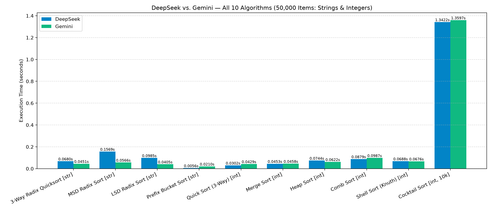

# Portfolio Exercise 2: Benchmarking Code Generation

We asked **DeepSeek** and **Gemini** to write **10 sorting algorithms** in Python. Then we tested both on the exact same data:

1. **50,000 random strings** (5–25 characters) for the 4 string sorts.
2. **50,000 random integers** (`0` to `1,000,000`) for 5 general sorts, and **10,000 integers** for the slow `Cocktail Sort`.
3. `compare_sorting.py` checks that every output matches `sorted()`, times each run, and saves a bar chart.

The bonus track in [`../comparison`](../comparison) does the same test with **10 string compression algorithms**.

## Files

| File | What it is |
| :--- | :--- |
| [`deepseek.py`](deepseek.py) | DeepSeek's 10 sorting functions (`get_algorithms()`) |
| [`gemini.py`](gemini.py) | Gemini's 10 sorting functions (`get_algorithms()`) |
| [`compare_sorting.py`](compare_sorting.py) | Generates test data, checks results, times all 10 pairs, and saves the chart |
| [`comparison_chart_2026-11-16_00-51-13.png`](comparison_chart_2026-11-16_00-51-13.png) | Bar chart of the sorting times |
| [`../comparison`](../comparison) | Bonus track: compression scripts, results, and chart |

## How to run

```bash
python compare_sorting.py
python ../comparison/deepseek_compression.py
python ../comparison/gemini_compression.py
```

Needs `matplotlib` (and `pandas` for the compression scripts; see `../../../../requirements.txt`).

## Results: sorting (50,000 items, seed 42)

All 10 algorithms in both files returned the right sorted order.

| Algorithm | Input | DeepSeek (s) | Gemini (s) | Faster |
| :--- | :--- | --: | --: | :--- |
| Prefix Bucket Sort | 50k strings | 0.0056 | 0.0210 | DeepSeek, 3.75x |
| Quick Sort (3-Way) | 50k ints | 0.0302 | 0.0429 | DeepSeek, 1.42x |
| LSD Radix Sort | 50k strings | 0.0985 | 0.0405 | Gemini, 2.43x |
| 3-Way Radix Quicksort | 50k strings | 0.0680 | 0.0451 | Gemini, 1.51x |
| Merge Sort | 50k ints | 0.0453 | 0.0458 | Tie (DeepSeek, 1.01x) |
| MSD Radix Sort | 50k strings | 0.1569 | 0.0566 | Gemini, 2.77x |
| Heap Sort | 50k ints | 0.0744 | 0.0622 | Gemini, 1.20x |
| Shell Sort (Knuth) | 50k ints | 0.0688 | 0.0676 | Tie (Gemini, 1.02x) |
| Comb Sort | 50k ints | 0.0879 | 0.0987 | DeepSeek, 1.12x |
| Cocktail Sort | 10k ints | 1.3422 | 1.3597 | Tie (DeepSeek, 1.01x) |



## Reflection: code quality of the two chatbots

**String sorts (Radix and Bucket).**
- **MSD and LSD Radix Sort:** DeepSeek uses a `count` list and a helper array. Gemini puts strings into 257 Python lists (`buckets`). In MSD Radix Sort, DeepSeek loops over all 256 buckets at every step, even when most are empty. Gemini skips empty buckets (`if buckets[b]:`). This makes Gemini **2.77x faster** on MSD and **2.43x faster** on LSD.
- **3-Way Radix Quicksort:** DeepSeek swaps items in place using indexes. Gemini builds three new lists (`less`, `equal`, `greater`) on each call. In Python, `list.append` in C is faster than many index swaps in Python, so Gemini wins by **1.51x**.
- **Prefix Bucket Sort:** DeepSeek supports both numbers and strings. For strings, it groups by the first letter (`s[0]`) and sorts each bucket with Python's built-in `sorted()`. Gemini groups by the first two letters (`s[:2]`) and sorts each bucket with its own `quick_sort()`. Because `sorted()` runs in C, DeepSeek is **3.75x faster**, though Gemini relies less on built-in sort.

**General sorts.**
- **Quick Sort (3-Way):** Both split the input into `less`, `equal`, and `greater` lists. DeepSeek does this in one `for` loop. Gemini uses three list comprehensions, so it loops over the array three times per call. DeepSeek is **1.42x faster**.
- **Comb Sort:** Both versions are almost the same. DeepSeek saves `n = len(a)` once, while Gemini calls `len(a)` inside the `while` loop on every step. DeepSeek is **1.12x faster**.
- **Heap, Merge, Shell, and Cocktail Sort:** Both chatbots wrote almost the same code for these four, and their speeds are nearly equal.

**Overall.** Gemini's list-based buckets work better in Python for radix sorts. DeepSeek writes tighter loops for quicksort and comb sort, and handles both numbers and strings in bucket sort.

## Bonus: compression (100,000 strings, 1.56 MB)

Both chatbots picked the same 10 algorithms: five from the standard library (`zlib` level 1 and 6, `gzip`, `bz2`, `lzma`) and five in pure Python (Huffman, LZW, LZ77, byte-pair encoding, RLE). Every algorithm restored the exact original bytes.

| Algorithm | Compress (s) | Decompress (s) | Compressed size (% of original) |
| :--- | --: | --: | --: |
| Fast Deflate (zlib L1) | 0.029 | 0.003 | 77.0 |
| Gzip | 0.038 | 0.003 | 75.1 |
| Deflate (zlib L6) | 0.040 | 0.003 | 75.1 |
| Bzip2 | 0.066 | 0.039 | 75.3 |
| LZW | 0.164 | 0.050 | 89.0 |
| Run-Length Encoding | 0.149 | 0.129 | 197.2 |
| LZMA | 0.327 | 0.068 | 75.6 |
| Huffman | 0.123 | 0.354 | 74.2 |
| LZ77 | 1.023 | 0.136 | 483.2 |
| Byte-Pair Encoding | 7.517 | 0.643 | 192.9 |


Random text has almost no repeated patterns. The best a compressor can do is pack 62 characters into about 6 bits instead of 8 bits (around 75% of the original size). RLE, LZ77, and BPE actually make the data bigger because their extra pointers and counts take more space than they save.

**Reflection.** Here the two scripts are almost identical. They only differ in output format: Gemini uses `pandas` and saves a chart, while DeepSeek prints a plain-text table with speed in MB/s.
