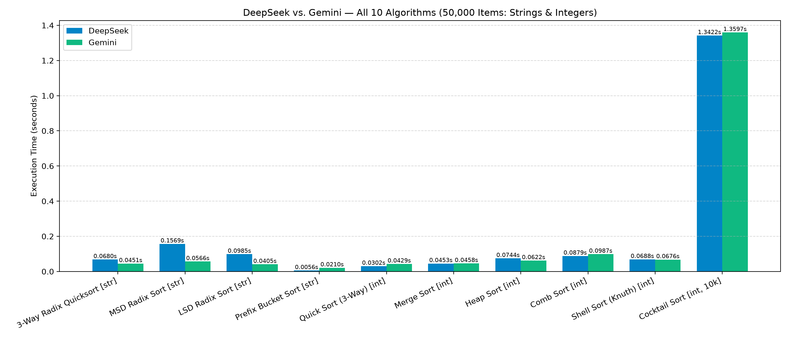
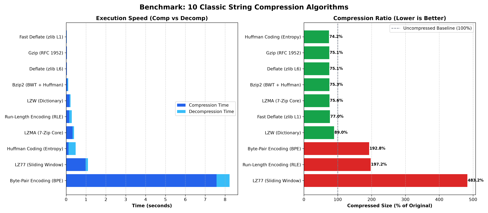

# Portfolio Exercise 2: Benchmarking Code Generation

Two chatbots, **DeepSeek** and **Gemini**, were each used to implement **10 sorting algorithms** in Python and compared head-to-head on identical inputs:

1. **50,000 random strings** (5–25 alphanumeric characters, seed `42`) for the 4 string-specific algorithms,
2. **50,000 random integers** (`0` to `1,000,000`, seed `42`) for the 5 general $O(n \log n)$ / sub-quadratic comparison sorts, and **10,000 integers** for the quadratic `Cocktail Sort`,
3. `compare_sorting.py` verifies that every algorithm from both chatbots matches Python's `sorted()`, times each with `time.perf_counter()`, and generates a side-by-side comparison chart.

The bonus track in [`../comparison`](../comparison) repeats this benchmark with **10 string compression algorithms** (speed and compression ratio).

## Files

| File | What it is |
| :--- | :--- |
| [`deepseek.py`](deepseek.py) | DeepSeek's implementations of the 10 sorting algorithms (`get_algorithms()`) |
| [`gemini.py`](gemini.py) | Gemini's implementations of the same 10 sorting algorithms (`get_algorithms()`) |
| [`compare_sorting.py`](compare_sorting.py) | Benchmark runner: generates test data, validates outputs, times all 10 pairs, and saves `comparison_chart_<timestamp>.png` |
| [`comparison_chart_2026-11-16_00-51-13.png`](comparison_chart_2026-11-16_00-51-13.png) | Latest benchmark chart comparing DeepSeek and Gemini across all 10 algorithms |
| [`../comparison`](../comparison) | Bonus track: `deepseek_compression.py`, `gemini_compression.py`, their result files, and `compression_benchmark_results.png` |

## How to run

```bash
python compare_sorting.py
python ../comparison/deepseek_compression.py
python ../comparison/gemini_compression.py
```

Requires `matplotlib` (and `pandas` for the compression scripts; see the repo's `../../../../requirements.txt`).

## Results: sorting (50,000 items, seed 42)

Every algorithm in both modules returned the exact same sorted list as `sorted()`.

| Algorithm | Input | DeepSeek (s) | Gemini (s) | Faster |
| :--- | :--- | --: | --: | :--- |
| Prefix Bucket Sort | 50k strings | 0.0056 | 0.0210 | DeepSeek, 3.75x |
| Quick Sort (3-Way) | 50k ints | 0.0302 | 0.0429 | DeepSeek, 1.42x |
| LSD Radix Sort | 50k strings | 0.0985 | 0.0405 | Gemini, 2.43x |
| 3-Way Radix Quicksort | 50k strings | 0.0680 | 0.0451 | Gemini, 1.51x |
| Merge Sort | 50k ints | 0.0453 | 0.0458 | Tie (DeepSeek, 1.01x) |
| MSD Radix Sort | 50k strings | 0.1569 | 0.0566 | Gemini, 2.77x |
| Heap Sort | 50k ints | 0.0744 | 0.0622 | Gemini, 1.20x |
| Shell Sort (Knuth) | 50k ints | 0.0688 | 0.0676 | Tie (Gemini, 1.02x) |
| Comb Sort | 50k ints | 0.0879 | 0.0987 | DeepSeek, 1.12x |
| Cocktail Sort | 10k ints | 1.3422 | 1.3597 | Tie (DeepSeek, 1.01x) |



## Reflection: code quality of the two chatbots

**String-specific algorithms (Radix & Bucket sorts).**
- **MSD and LSD Radix Sort:** DeepSeek writes textbook index-based counting sort (`count` array of size 258 and `aux` buffer), while Gemini groups strings into 257 Python lists (`buckets[code].append(s)`). In MSD Radix Sort, DeepSeek loops over all 256 character values at every recursive step even when almost all buckets are empty, whereas Gemini only recurses on non-empty buckets (`if buckets[b]:`), making Gemini **2.77x faster** on MSD (`0.0566s` vs `0.1569s`) and **2.43x faster** on LSD (`0.0405s` vs `0.0985s`).
- **3-Way Radix Quicksort:** DeepSeek implements Bentley–Sedgewick's in-place 3-way index swaps (`lo`, `lt`, `gt`, `hi`), while Gemini partitions into three new Python lists (`less`, `equal`, `greater`) per recursive call. In CPython, bulk list appends beat repeated element-by-element index swaps, giving Gemini a **1.51x** edge (`0.0451s` vs `0.0680s`).
- **Prefix Bucket Sort:** DeepSeek supports both numeric and string inputs (`isinstance(x, (int, float))`), buckets strings by their 1-character prefix (`s[0]`), and sorts each bucket with Python's built-in C `sorted()`. Gemini buckets only strings by 2-character prefix (`s[:2]`) and sorts each bucket with its own pure-Python `quick_sort()`. Delegating bucket sorting to Timsort makes DeepSeek **3.75x faster** (`0.0056s` vs `0.0210s`), though Gemini's 2-character bucketing + custom sort is more faithful to a self-contained algorithm implementation.

**General comparison algorithms.**
- **Quick Sort (3-Way):** Both partition into three lists (`less`, `equal`, `greater`), but DeepSeek partitions in a single `for` loop (`if / elif / else`), whereas Gemini runs three separate list comprehensions over `arr` per call. Single-pass partitioning makes DeepSeek **1.42x faster** (`0.0302s` vs `0.0429s`).
- **Comb Sort:** Nearly identical, except DeepSeek caches `n = len(a)` before the loop while Gemini calls `len(a)` on every iteration of the inner `while` loop (`0.0879s` vs `0.0987s`, **1.12x** faster for DeepSeek).
- **Heap, Merge, Shell, and Cocktail Sort:** Both chatbots produced virtually identical implementations (iterative `sift_down` heap sort, Knuth `3*g + 1` shell sort, recursive merge sort, and bidirectional cocktail shaker sort) with very close runtimes.

**Overall.** When constrained to the exact same 10 algorithms, Gemini's idiomatic Python list-bucketing wins on the radix sorts, while DeepSeek writes tighter loops (single-pass 3-way quicksort, cached length in comb sort, and type-aware bucket sort).

## Bonus: compression (100,000 strings, 1.56 MB)

Both chatbots picked the same 10 algorithms: five from the standard library (zlib level 6 and level 1, gzip, bz2, lzma) and five written in pure Python (Huffman, LZW, LZ77, byte-pair encoding, RLE). Every algorithm decompressed back to the original bytes. Numbers below are from `deepseek_compression.py`; Gemini's script produces the same sizes and near-identical times.

| Algorithm | Compress (s) | Decompress (s) | Compressed size (% of original) |
| :--- | --: | --: | --: |
| Fast Deflate (zlib L1) | 0.029 | 0.003 | 77.0 |
| Gzip | 0.038 | 0.003 | 75.1 |
| Deflate (zlib L6) | 0.040 | 0.003 | 75.1 |
| Bzip2 | 0.066 | 0.039 | 75.3 |
| LZW | 0.164 | 0.050 | 89.0 |
| Run-Length Encoding | 0.149 | 0.129 | 197.2 |
| LZMA | 0.327 | 0.068 | 75.6 |
| Huffman | 0.123 | 0.354 | 74.2 |
| LZ77 | 1.023 | 0.136 | 483.2 |
| Byte-Pair Encoding | 7.517 | 0.643 | 192.9 |



Random alphanumeric text has almost no repetition, so the only gain available is packing a 62-symbol alphabet into about 6 bits instead of 8, which is why everything with an entropy coder lands near 75%. RLE, LZ77 and BPE make the data bigger because their counts, pointers and 16-bit tokens cost more than the repeats they find.

**Reflection.** Here the two solutions are nearly the same code: same algorithms, same pure-Python implementations almost line for line. They differ only in the reporting, where Gemini uses a `pandas` table and a chart and DeepSeek prints a plain-text table with throughput in MB/s. Both originally ran the pure-Python algorithms on a 10,000-string sample, which made the ratios not comparable across algorithms; both now run everything on the full dataset.
