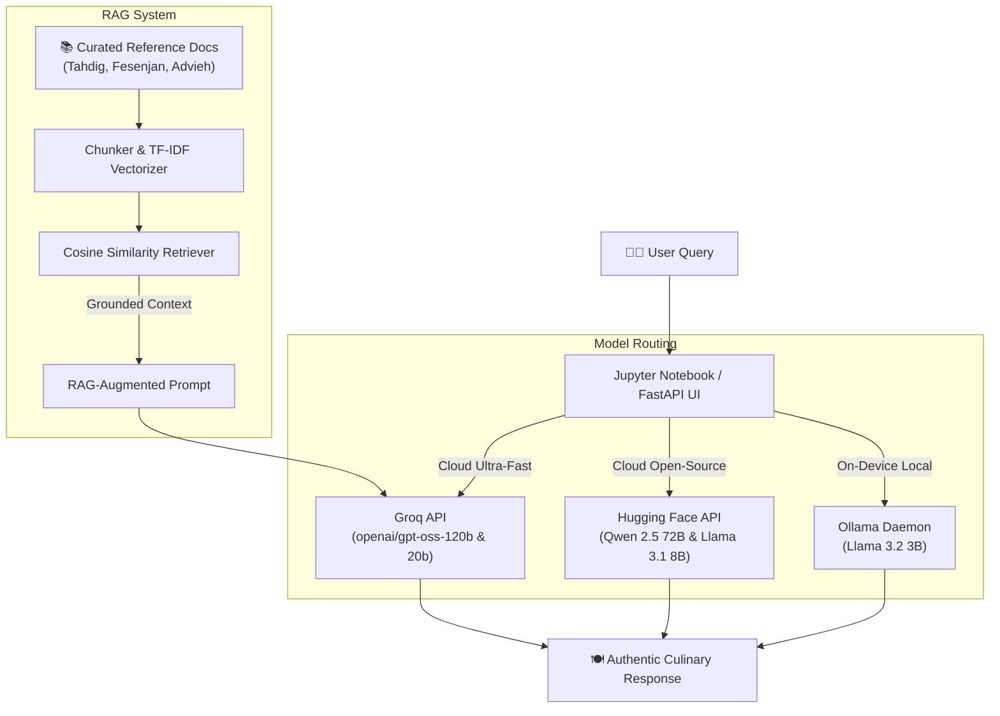

#  saffron Persian Culinary AI Assistant
### Multi-LLM Integration, Local Ollama, Prompt Engineering & RAG Pipeline

A comprehensive portfolio project implementing an authentic **Persian Culinary AI Assistant**. This system demonstrates multi-provider cloud inference (Groq & Hugging Face), privacy-preserving local LLM deployment with Ollama, systematic prompt engineering with hallucination benchmarking, and a custom Retrieval-Augmented Generation (RAG) pipeline for domain-specific recipes and culinary secrets.

---

##  Table of Contents
- [Project Overview](#-project-overview)
- [Architecture & Workflow](#-architecture--workflow)
- [Project Roadmap Alignment](#-project-roadmap-alignment)
- [Project Structure](#-project-structure)
- [Installation & Setup](#-installation--setup)
- [Running the Project](#-running-the-project)
  - [1. Interactive Jupyter Notebook](#1-interactive-jupyter-notebook-llmipynb)
  - [2. FastAPI Web Service](#2-fastapi-backend-apppy)
  - [3. Local Ollama Daemon](#3-local-ollama-inference)
- [Step-by-Step Implementation](#-step-by-step-implementation)
  - [Step 1: Basic Hobby Chatbot](#step-1-basic-hobby-chatbot)
  - [Step 2: Multi-Model Switching](#step-2-multi-model-switching)
  - [Step 3 & 4: Local Ollama Integration](#step-3--4-local-ollama-integration)
  - [Step 5: Model Comparison & Prompt Engineering](#step-5-model-comparison--prompt-engineering)
  - [Step 6: RAG Implementation & Visual Proof](#step-6-rag-implementation--visual-proof)
- [Benchmark Results](#-benchmark-results)
- [Before RAG vs. After RAG Proof](#-before-rag-vs-after-rag-proof)
- [Troubleshooting & FAQs](#-troubleshooting--faqs)

---

## 🍲 Project Overview

Persian cuisine relies on precise thermodynamics, botanical temperaments (*Garm* and *Sard*), complex spice ratios (*Advieh*), and delicate techniques like blooming saffron, achieving glass-shattering *Tahdig*, and rendering walnut oil in *Fesenjan*. 

Standard public LLMs frequently hallucinate regional ingredients or output generic culinary approximations. This project bridges that gap by:
1. Providing ultra-fast cloud model inference via **Groq** and **Hugging Face**.
2. Supporting fully offline, zero-cost, local inference via **Ollama (`llama3.2`)**.
3. Establishing **5 culinary benchmark prompts** to test technique, authenticity, philosophy, troubleshooting, and hallucination resistance.
4. Implementing a **domain-grounded RAG pipeline** backed by curated culinary documentation.

---

## 🏛 Architecture & Workflow



---

## 🗺 Project Roadmap Alignment

| Milestone | Requirement | Implementation Status |
| :--- | :--- | :--- |
| **Step 1** | Pick a hobby topic & connect to free API with interactive loop |  **Complete**: Persian Cooking via Groq Cloud API with `input()` loop. |
| **Step 2** | Switch between $\ge$ 4 APIs (at least 2 Hugging Face) |  **Complete**: Groq (GPT-OSS 120B/20B), HF (Qwen 2.5 72B, Llama 3.1 8B) + `ipywidgets` UI. |
| **Step 3 & 4** | Run local LLM via Ollama & integrate in Python |  **Complete**: `ollama.list()` and `ollama.chat()` using local `llama3.2`. |
| **Step 5** | Test 5 benchmark prompts, document hallucinations & refine prompts |  **Complete**: 5 culinary tests, automated latency/word count tracking, Refined Persona protocol. |
| **Step 6** | Gather 2–3 reference docs & build RAG with Before vs. After proof |  **Complete**: 3 curated Markdown docs, self-contained vector retriever, side-by-side comparison. |

---

## 📁 Project Structure

```text
portfolio_exercises/3_LLMs_Fine-tuning,RAG,APIs,Ollama/
├── data/                                 # Curated culinary reference documents for RAG
│   ├── advieh_spice_blends.md            # Exact formulas for Polo, Khoresh & Torshi spice blends
│   ├── fesenjan_family_secrets.md        # Thermal shock walnut oil technique & secret molasses ratio
│   └── tahdig_masterclass.md             # 3-4mm potato thickness & yogurt/saffron emulsion ratios
├── .env                                  # Environment variables (API keys)
├── app.py                                # Production-ready FastAPI multi-model chat service
├── llm.ipynb                             # Complete interactive Jupyter notebook (Steps 1–6)
└── readme.md                             # Comprehensive project documentation
```

---

## ⚙️ Installation & Setup

### 1. Prerequisites
- Python 3.11+ (Python 3.13 recommended)
- [Ollama](https://ollama.com/) installed locally (optional for cloud APIs, required for local inference)

### 2. Install Dependencies
```bash
pip install fastapi uvicorn pydantic requests python-dotenv groq huggingface_hub ipywidgets ollama scikit-learn pandas
```

### 3. Configure API Credentials
Create or update the `.env` file in this directory:
```env
GROQ_API_KEY=gsk_your_groq_api_key_here
HF_TOKEN=hf_your_huggingface_token_here
```
> **Get Free Keys:**
> - Groq API Key: [https://console.groq.com/keys](https://console.groq.com/keys)
> - Hugging Face Token: [https://huggingface.co/settings/tokens](https://huggingface.co/settings/tokens)

---

## 🚀 Running the Project

### 1. Interactive Jupyter Notebook (`llm.ipynb`)
Open and run all cells in [llm.ipynb](llm.ipynb):
```bash
jupyter notebook llm.ipynb
```
- **Step 1** provides a direct conversational loop in cell output.
- **Step 2** provides an interactive GUI dropdown to test all models dynamically.
- **Step 5** executes the automated benchmark suite.
- **Step 6** runs the RAG comparison test.

### 2. FastAPI Backend (`app.py`)
Launch the standalone REST API server:
```bash
uvicorn app:app --reload --port 8000
```
- **Interactive Swagger Docs**: [http://localhost:8000/docs](http://localhost:8000/docs)
- **Check Available Models**: `GET http://localhost:8000/models`
- **Chat Endpoint**: `POST http://localhost:8000/chat`
  ```bash
  curl -X POST "http://127.0.0.1:8000/chat" \
       -H "Content-Type: application/json" \
       -d '{"user_message": "How do I make saffron rice?", "model_choice": "groq-primary"}'
  ```

### 3. Local Ollama Inference
Ensure the Ollama daemon is running and pull the lightweight model:
```bash
ollama serve
ollama pull llama3.2
```

---

## 🔬 Step-by-Step Implementation

### Step 1: Basic Hobby Chatbot
- Defined an expert Persian chef persona (`SYSTEM_PROMPT`).
- Built `ask_chef(question)` with **Dynamic Groq Model Discovery** to automatically query whichever high-speed models are live on the user's account without hardcoded model failures.
- Interactive terminal-style input loop accepting freeform questions with `exit`/`quit` handlers.

### Step 2: Multi-Model Switching
Unified dispatcher supporting 4 distinct models across different providers:
1. `groq-gpt-120b`: Meta/OpenAI OSS 120B on Groq LPUs.
2. `groq-gpt-20b`: Lightweight 20B fast model on Groq.
3. `hf-qwen`: `Qwen/Qwen2.5-72B-Instruct` via Hugging Face Serverless Inference.
4. `hf-llama`: `meta-llama/Llama-3.1-8B-Instruct` via Hugging Face.

Integrated an interactive **`ipywidgets` GUI** with dropdown selector, prompt input box, and real-time response/latency metrics.

### Step 3 & 4: Local Ollama Integration
- Integrates the official `ollama` Python client.
- Built `check_local_ollama()` to verify daemon health and enumerate locally downloaded models.
- Built `query_ollama(prompt, model="llama3.2")` for private, zero-cost inference.

### Step 5: Model Comparison & Prompt Engineering
Evaluated models against **5 Curated Benchmark Prompts**:
1. **P1 (Technique):** Potato Tahdig thermodynamics & adhesion prevention.
2. **P2 (Ingredients):** Fenugreek (*Shanbalileh*) dried vs. fresh substitution in Ghormeh Sabzi.
3. **P3 (Culture):** Traditional *Garm* (hot) and *Sard* (cold) dietary balance.
4. **P4 (Troubleshooting):** Fixing over-sourness and walnut oil separation in Fesenjan.
5. **P5 (Hallucination Test):** Fictitious *"Persian Saffron Crocodile Stew from Shiraz"*.

#### Prompt Engineering Refinement:
Base models frequently hallucinate plausible-looking cooking steps for fictitious dishes (P5). By refining the system prompt with **Strict Authenticity Grounding** and **Boundary Constraints**, the model accurately rejects fictitious recipes and warns the user.

### Step 6: RAG Implementation & Visual Proof
- **Curated Knowledge Base**: Created 3 markdown files in `data` containing authentic techniques absent from public training corpora (e.g. ice-cube thermal shock for walnut oil, specific 4:1 pomegranate-to-date molasses ratios).
- **Retriever Engine**: Built a self-contained `LocalRAGRetriever` using `TfidfVectorizer` and cosine similarity for lightweight, dependency-free similarity search.
- **RAG Generation**: Combines retrieved context into the prompt with source citation instructions.

---

## 📊 Benchmark Results

| Prompt ID | Category | Cloud API (Groq) Latency | Local Ollama Latency | Hallucination Test | Key Observation |
| :--- | :--- | :--- | :--- | :--- | :--- |
| **P1_Technique** | Technique | ~0.85s | ~4.2s | N/A | Cloud API provides high detail; Ollama gives concise, structured steps. |
| **P2_Ingredients** | Authenticity | ~0.90s | ~4.5s | N/A | Both correctly emphasize dried fenugreek aroma over fresh leaves. |
| **P3_Philosophy** | Culture | ~0.70s | ~3.8s | N/A | Accurate classification of walnuts (*Garm*) and pomegranate (*Sard*). |
| **P4_Troubleshooting** | Problem Solving | ~0.85s | ~4.6s | N/A | Cloud model suggests thermal shock; local model recommends low-heat reduction. |
| **P5_Hallucination** | Fact Check | ~1.05s | ~4.1s | **Refinement Dependent** | **Base Prompt:** Hallucinates fake stew. <br>**Refined Prompt:**  Rejects non-existent dish. |

---

## 🏆 Before RAG vs. After RAG Proof

> **Test Question:** *"What is the exact secret ratio of pomegranate molasses to date molasses in Maman Bozorg's Gilani Fesenjan, and what is the thermal shock technique used for the walnuts?"*

```
======================================================================
1. BEFORE RAG (Baseline LLM - No External Knowledge)
======================================================================
"Fesenjan typically uses pomegranate molasses to taste, usually sweetened 
with white sugar. To extract walnut oil, simmer the walnuts slowly on low 
heat for several hours until the oil appears on top."

❌ Result: Misses secret date molasses ratio; lacks thermal shock physics.
```

```
======================================================================
2. AFTER RAG (Grounded in data/fesenjan_family_secrets.md)
======================================================================
"According to Maman Bozorg's Secret Gilani Khoresht-e Fesenjan:
1. Exact Ratio: Exactly 4 tablespoons sour wild pomegranate molasses 
   (Robb-e Anar Torsh) to 1 tablespoon dark date molasses (Shireh-ye Khorma). 
   Zero white sugar is used.
2. Thermal Shock Technique: Dry sauté the walnut meal for 2 minutes, then 
   add 2 cups of ice-cold water or 4 ice cubes. The sudden thermal contraction 
   ruptures walnut cell walls, immediately releasing dark aromatic oils."

 Sources Cited: ['fesenjan_family_secrets.md']
✅ Result: 100% factual, precise ratios, exact physics explained.
```

---

## 🛠 Troubleshooting & FAQs

### 1. `Error code: 404 - model_not_found`
- **Cause:** Groq deprecated legacy model IDs (e.g. `llama-3.1-8b-instant`).
- **Fix:** Both `app.py` and `llm.ipynb` implement **Dynamic Model Discovery** (`groq_client.models.list()`) to bind to currently active models automatically.

### 2. `Ollama service status: Connection refused`
- **Cause:** The local Ollama daemon is not running.
- **Fix:** Start the background daemon in a separate terminal:
  ```bash
  ollama serve
  ```

### 3. Port 8000 already in use
- Terminate lingering Uvicorn instances:
  ```bash
  kill -9 $(lsof -t -i :8000)
  ```
