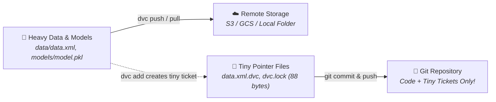

# 📦 Part 3: Data Versioning with DVC (Mini Exercise 3)

> **Course Reference:** `08 MLOps.pdf` — **Slides 25–29 (Mini Exercise 3: Run the DVC Get Started Tutorial)**  
> **Official Docs:** 🔗 [DVC Get Started Guide](https://doc.dvc.org/start)

---

## 💡 1. What Is the Problem? (In Simple Words)

Suppose you train a model on `data_v1.csv` (or 5,000 flower photos). Next week, someone adds new data and overwrites the file. Suddenly, your model's accuracy drops!
* *"What changed in the data?"*
* *"Can we go back to version 1 of the dataset?"*

Why can't we just put a 5 GB dataset inside **Git / GitHub**?
* **Git is built for text code, NOT huge data files!** Putting gigabytes of images or CSVs in Git makes your repository slow, bloated, and GitHub blocks files over 100 MB.

### The Solution: **DVC = "Git for Data"** (Slide 27)
Think of DVC like a **coat check ticket**:
1. You hand your heavy winter coat (**your 5 GB dataset `data.xml`**) to the storage room (**DVC Cache / Cloud Storage** like Google Drive, S3, or a local folder).
2. DVC gives you a tiny paper ticket (**`data.xml.dvc`**, only 80 bytes!) with a unique fingerprint (MD5 hash) of your coat.
3. You put that **tiny ticket inside Git** (`git add data.xml.dvc`), and tell Git to ignore the heavy coat (`.gitignore`).



---

## 🗂️ 2. Files in This Folder (`3_DVC/`)

| File / Folder | Tracked by Git or DVC? | Simple Explanation |
| :--- | :---: | :--- |
| **`data/data.xml`** | 📦 **DVC** *(Ignored by Git)* | The actual raw XML dataset containing text posts and `0/1` target labels. |
| **[`data/data.xml.dvc`](data/data.xml.dvc)** | 🐙 **Git** | The tiny 4-line "claim ticket" containing the MD5 fingerprint (`951927...`) of `data.xml`. |
| **[`params.yaml`](params.yaml)** | 🐙 **Git** | Settings for data splitting (`split: 0.2`, `seed: 42`) and training (`max_features: 200`). |
| **[`src/prepare.py`](src/prepare.py)** | 🐙 **Git** | **Stage 1:** Reads `data/data.xml` and splits it into `data/prepared/train.tsv` and `test.tsv`. |
| **[`src/train.py`](src/train.py)** | 🐙 **Git** | **Stage 2:** Trains a TF-IDF + Logistic Regression model and saves `models/model.pkl`. |
| **[`src/evaluate.py`](src/evaluate.py)** | 🐙 **Git** | **Stage 3:** Tests the model on `test.tsv` and writes `accuracy` and `f1` into `metrics.json`. |
| **[`dvc.yaml`](dvc.yaml)** | 🐙 **Git** | Defines the 3-step pipeline (`prepare` $\rightarrow$ `train` $\rightarrow$ `evaluate`) so DVC can run everything automatically. |
| **[`dvc.lock`](dvc.lock)** | 🐙 **Git** | Records the exact MD5 fingerprints of every input and output from the last pipeline run. |
| **[`metrics.json`](metrics.json)** | 🐙 **Git** | Final test scores (`{"accuracy": 0.5, "f1": 0.6667, "test_samples": 2}`). |

---

## 🔍 3. Essential DVC Commands Explained Simply (Slide 28)

### A. Basic Data Versioning Commands (From Slide 28)

| Step | Command | What It Does in Plain English |
| :---: | :--- | :--- |
| **1** | `dvc init` | Turns on DVC inside your Git folder (creates the hidden `.dvc/` folder). |
| **2** | `dvc remote add -d myremote <path>` | Tells DVC where the "storage room" is (a local folder, Google Drive, S3, or GCS bucket). |
| **3** | `dvc add data/data.xml` | Moves `data.xml` into DVC's care, adds it to `.gitignore`, and creates the tiny ticket `data.xml.dvc`. |
| **4** | `git add data/data.xml.dvc data/.gitignore`<br/>`git commit -m "Add training data"` | Saves the tiny ticket into Git history. |
| **5** | `dvc push` | Uploads the heavy data files from your laptop to the remote storage room. |
| **6** | `git pull` then `dvc pull` | On another computer: `git pull` downloads the code & tickets, and `dvc pull` uses the tickets to download the heavy data files! |

### B. Bonus Pipeline Commands (Implemented in This Folder)

DVC can also connect your scripts (`prepare.py` $\rightarrow$ `train.py` $\rightarrow$ `evaluate.py`) into a smart pipeline using [`dvc.yaml`](dvc.yaml):

| Command | What It Does in Plain English |
| :--- | :--- |
| **`dvc repro`** | Runs the whole pipeline (`prepare` $\rightarrow$ `train` $\rightarrow$ `evaluate`), **but skips any step whose data, code, and parameters haven't changed!** |
| **`dvc dag`** | Draws an ASCII flowchart in your terminal showing how your data and stages connect. |
| **`dvc metrics show`** | Prints a clean table of your model's accuracy and F1 score from `metrics.json`. |
| **`dvc params diff`** | Shows which hyperparameters in `params.yaml` changed compared to your last Git commit. |

---

## 🚀 4. How to Run & Test This Exercise

```bash
cd /Users/nooshin/Uni/Data/data6/data6/MLOps/3_DVC
source ../../.venv/bin/activate

# 1. Check the tiny pointer ticket that Git tracks
cat data/data.xml.dvc

# 2. Run the 3-stage pipeline (if nothing changed, DVC skips stages instantly!)
dvc repro

# 3. View the pipeline flowchart and evaluation scores
dvc dag
dvc metrics show
```
*(Note: If `dvc` is not yet installed in `.venv`, run `python -m pip install dvc` first).*
