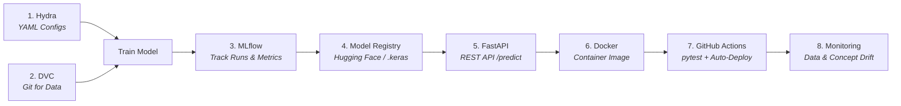

# ⚙️ MLOps (Machine Learning Operations) — Complete Study Guide & Exercise Solutions

> **Course:** Data & A.I. 6 (DAI6) — Karel de Grote Hogeschool (KdG)  
> **Lecture Slide Deck:** `08 MLOps.pdf` (Geert De Paepe / Jan van Sas, Slides 1–75)

---

## 🧭 1. Quick Map of All Exercises in This Folder

This `MLOps/` folder contains clean, runnable implementations and simple-English explanations for all **4 Mini Exercises** from `08 MLOps.pdf`, plus a complete walkthrough of the whole slide deck:

| Exercise from `08 MLOps.pdf` | Folder & Files | Simple Study Guide |
| :--- | :--- | :--- |
| **Mini Exercise 1: Hydra Configuration Management**<br/>*(Slides 7–15)* | • **1.1 Basic Tutorial:** [`1_configure_management/basic/simple_cli/`](1_configure_management/basic/simple_cli/)<br/>• **1.2 Configuring Experiments:** [`1_configure_management/patterns/configuring_experiments/`](1_configure_management/patterns/configuring_experiments/)<br/>• **1.3 Instantiating Objects:** [`1_configure_management/advanced/instantiate_objects/`](1_configure_management/advanced/instantiate_objects/)<br/>• **1.4 Sweeping (Grid Search):** [`1_configure_management/basic/running_your_app/multi_run/`](1_configure_management/basic/running_your_app/multi_run/)<br/>• **1.5 Hydra in Notebooks:** [`1_configure_management/advanced/jupyter_notebooks/`](1_configure_management/advanced/jupyter_notebooks/) | 📖 **[`1_configure_management/README.md`](1_configure_management/README.md)** |
| **Mini Exercise 2: MLflow 5-Minute Quickstart**<br/>*(Slides 16–24)* | • [`2_MLFLow/QuickStart/mlflow-5min-quickstart.ipynb`](2_MLFLow/QuickStart/mlflow-5min-quickstart.ipynb) | 📖 **[`2_MLFLow/QuickStart/README.md`](2_MLFLow/QuickStart/README.md)** |
| **Mini Exercise 3: DVC Data Versioning & Pipelines**<br/>*(Slides 25–29)* | • [`3_DVC/data/data.xml.dvc`](3_DVC/data/data.xml.dvc)<br/>• [`3_DVC/dvc.yaml`](3_DVC/dvc.yaml) & [`params.yaml`](3_DVC/params.yaml)<br/>• [`3_DVC/src/prepare.py`](3_DVC/src/prepare.py), [`train.py`](3_DVC/src/train.py), [`evaluate.py`](3_DVC/src/evaluate.py) | 📖 **[`3_DVC/README.md`](3_DVC/README.md)** |
| **Mini Exercise 4: FastAPI Deployment (+Upgrade)**<br/>*(Slides 37–42)* | • [`4_FastAPI/main.py`](4_FastAPI/main.py) *(Slide 41 Example + Upgrade)*<br/>• [`4_FastAPI/test_main.py`](4_FastAPI/test_main.py) *(Pytest Unit Tests)* | 📖 **[`4_FastAPI/README.md`](4_FastAPI/README.md)** |

---

## 🎯 2. The Whole Slide Deck Explained Simply (Slides 1–75)

### Part 1: What Is MLOps? (Slides 1–6)

**Simple Definition:** **MLOps = Machine Learning + Operations**. It is the set of tools and habits that take a model out of your Jupyter Notebook and keep it running reliably in the real world.

> 🚨 **Why do we need MLOps?** Because **87% of ML projects never make it to production!** (Slide 4)

| In a Jupyter Notebook (✅ Easy) | In Real-World Production (❌ Hard without MLOps) | Which MLOps Tool Solves It? |
| :--- | :--- | :--- |
| Settings are typed directly in Python cells. | *"How do we run 20 parameter experiments without editing code?"* | **Hydra** *(Part 2, Slides 7–15)* |
| Model gets 95% accuracy today. | *"Wait, which of my 50 runs was the best? What were its parameters?"* | **MLflow** *(Part 3, Slides 16–24)* |
| Loads `data_v1.csv` from your Desktop. | *"The data changed to `v2` and accuracy dropped! Can we go back to `v1`?"* | **DVC** *(Part 4, Slides 25–29)* |
| Model lives in notebook RAM. | *"How do we save and share the model safely with the team?"* | **Model Registry / Hugging Face** *(Part 5, Slides 30–36)* |
| You run cells by pressing `Shift+Enter`. | *"How does a website or mobile app get predictions from our model?"* | **FastAPI** *(Part 6, Slides 37–42)* |
| *"It works on my laptop!"* | *"It crashes on the cloud server because of different Python packages!"* | **Docker** *(Part 7, Slides 43–49)* |
| You test code manually when you remember. | *"How do we test code and deploy containers automatically on every `git push`?"* | **pytest + GitHub Actions (CI/CD)** *(Part 8, Slides 50–61)* |
| Dataset is frozen in time. | *"Real-world customer behavior changed and our model is silently decaying!"* | **Model Monitoring (Evidently AI)** *(Part 9, Slides 62–66)* |



---

### Part 2: Configuration Management with Hydra (Slides 7–15)
*(Full hands-on code in [`1_configure_management/`](1_configure_management/README.md))*

| Slide Topic | Simple Explanation | Key Command / Syntax |
| :--- | :--- | :--- |
| **Basic YAML Config (Slide 10)** | Put all settings (`epochs: 20`, `learning_rate: 0.0005`) in `config.yaml` and decorate your Python function with `@hydra.main`. | `python app.py model.epochs=10` |
| **Configuring Experiments (Slide 11)** | Put small YAML files in `experiment/` that only list what changes from the default config. Start the file with `# @package _global_`. | `python app.py +experiment=exp_1` |
| **Instantiating Objects (Slide 12)** | Specify a Python class in YAML with `_target_: tensorflow.keras.optimizers.Adam` and build it in Python with one call. | `opt = instantiate(cfg.model.optimizer)` |
| **Sweeping / Grid Search (Slide 13)** | Test multiple parameter combinations automatically in `MULTIRUN` mode. | `python app.py -m lr=0.001,0.0001` |
| **Hydra in Notebooks (Slide 14)** | Since `@hydra.main` doesn't work inside `.ipynb` notebooks, use `initialize` and `compose`. | `with initialize(config_path="."): cfg = compose(...)` |

---

### Part 3: Experiment Tracking with MLflow (Slides 16–24)
*(Full hands-on notebook in [`2_MLFLow/QuickStart/`](2_MLFLow/QuickStart/README.md))*

* **Why?** Without tracking, after 50 runs you cannot remember which hyperparameters, dataset, and code version gave the best score.
* **What does MLflow record? (Slide 18)**
  1. **Parameters** (Inputs: `learning_rate`, `batch_size`, `epochs`).
  2. **Metrics** (Outputs: `accuracy`, `loss`, `F1 score`).
  3. **Artifacts** (Files: saved model weights, confusion matrix plots).
  4. **Metadata** (Git commit hash, dataset version, timestamp).

---

### Part 4: Data Versioning with DVC (Slides 25–29)
*(Full hands-on project in [`3_DVC/`](3_DVC/README.md))*

* **Why?** Git is only for small text code. **DVC ("Git for Data")** stores heavy data/models in remote storage (S3, Google Drive, GCS, or a local folder) and puts a tiny `.dvc` pointer file (containing the MD5 hash) inside Git.
* **Core workflow (Slide 28):**
  * Save data: `dvc add train.csv` $\rightarrow$ `git add train.csv.dvc .gitignore` $\rightarrow$ `git commit` $\rightarrow$ `dvc push`.
  * Download data: `git pull` (gets the `.dvc` pointer) $\rightarrow$ `dvc pull` (downloads the actual data).

---

### Part 5: Model Registry & Saving Models (Slides 30–36)

When your model finishes training, how should you save it to disk and share it?

#### 5.1. Saving Deep Learning & Classical Models (Slides 31–32)

| Format | Used For | What Is Saved? | Pros & Cons (Simple Words) |
| :--- | :--- | :--- | :--- |
| **`.pt` (PyTorch)** | PyTorch models | Usually only the **weights** (`state_dict`), using Python Pickle under the hood. | ⚠️ **Lower security** (Pickle files from strangers can run malicious code!) and you **need the original Python class code** to reload the weights. |
| **`.keras` (Keras / TensorFlow)** | Keras 3 & TensorFlow | **The complete model:** architecture (`config.json`), weights (HDF5/native), and optimizer state in a ZIP archive. | ✅ **Safe & Highly Portable:** Does not execute arbitrary code on load, and reloads in 1 line of code without needing the original Python model definition! |
| **`.pkl` (Pickle)** | Classical Python / Scikit-Learn | Any Python object. | ✅ Easy to use.<br/>❌ Security risk & breaks across different Python versions. |
| **`.joblib` (Joblib)** | Scikit-Learn models (e.g., Random Forest) | Python objects with large NumPy arrays. | ✅ Much faster than Pickle for models with big numeric arrays.<br/>❌ Still Python-only. |
| **`.onnx` (ONNX)** | Cross-platform production deployment | Universal graph + weights format. | ✅ Runs in any language (C++, C#, JavaScript, Python) and any framework.<br/>❌ Not every exotic model layer is supported. |

#### 5.2. Hugging Face Hub & Model Packaging Best Practices (Slides 33–36)

* **Hugging Face = "The GitHub of AI" (Slides 34–35):** Hosts pre-trained **Models**, **Datasets**, the **Transformers** library, and live demo **Spaces**. It uses **Git-Xet**, which splits giant model files into small chunks so uploading a new version only uploads the changed chunks!
* **Golden Rule of Model Packaging (Slide 36):**
  > ⚠️ **Common Mistake:** Saving *only* the model weights and forgetting the preprocessing steps!  
  > If you scaled images by `1/255.0` or used a `StandardScaler` during training, you **must** bundle the preprocessing pipeline, feature names/order, class labels, and `requirements.txt` together with the model!

---

### Part 6: Model Deployment Patterns & FastAPI (Slides 37–42)
*(Full hands-on app and tests in [`4_FastAPI/`](4_FastAPI/README.md))*

* **Typical REST API Endpoints for ML (Slide 39):**
  * `POST /predict` — Send input features/image, get model prediction back.
  * `GET /health` — Check if the web server and model are alive and healthy.
  * `GET /metrics` — Get performance and speed statistics.

---

### Part 7: Containerization with Docker (Slides 43–49)

#### 7.1. Why Docker? Solving *"It Works on My Machine!"* (Slides 44–45)
Your model works on your MacBook with Python 3.13, macOS libraries, and your local folders. When you copy the script to a Linux cloud server with Python 3.9, it crashes!
**Docker** packages your **OS + Python version + `requirements.txt` + code + model** into one sealed box.

| Docker Term (Slide 45) | Simple Everyday Analogy | What It Actually Is |
| :--- | :--- | :--- |
| **1. `Dockerfile`** | 📜 **The Recipe** | A small text file with step-by-step instructions on how to set up the environment. |
| **2. Docker Image** | 🎂 **The Frozen Cake Template** *(like a Class in OOP)* | A read-only snapshot built from the `Dockerfile` containing Linux, Python, libraries, and your code. |
| **3. Docker Container** | 🍽️ **A Running Slice of Cake** *(like an Object in OOP)* | A live, running instance of your Image listening on port `8000`. You can start 10 containers from 1 image! |
| **4. Docker Registry** | 🏪 **The Bakery Store (Docker Hub)** | Online storage where you `docker push` and `docker pull` images. |

#### 7.2. Line-by-Line `Dockerfile` & Best Practices (Slides 46–47)

```dockerfile
# 1. Start from a specific, lightweight Python image (NOT :latest!)
FROM python:3.13-slim

# 2. Create and enter the /app folder inside the container
WORKDIR /app

# 3. Copy requirements FIRST (Docker Layer Caching trick!)
COPY requirements.txt .
RUN pip install -r requirements.txt

# 4. Copy your application code AFTER installing requirements
COPY main.py .

# 5. Document that the container listens on port 8000
EXPOSE 8000

# 6. Start the FastAPI server when the container launches
CMD ["uvicorn", "main:app", "--host", "0.0.0.0", "--port", "8000"]
```

> [!TIP] 💡 Exam Question (Slide 47): Why Do We Copy `requirements.txt` *Before* `COPY main.py`?
> **Answer: Layer Caching!** Docker saves a snapshot ("layer") after every line in your `Dockerfile`.
> * Installing `tensorflow` and `fastapi` with `pip install` takes 2 minutes.
> * If you copy `requirements.txt` first and run `pip install`, Docker **caches** that layer. Next time you edit a line in `main.py` and run `docker build`, Docker sees `requirements.txt` didn't change—so it **skips `pip install` completely** and builds your image in **1 second**!

| Essential Docker Command (Slide 46) | What It Does |
| :--- | :--- |
| `docker build -t username/flower-web .` | Builds the Docker image from the `Dockerfile` in the current folder (`.`). |
| `docker run -d -p 8000:8000 username/flower-web` | Runs the container in the background (`-d`) and connects your laptop's port `8000` to the container's port `8000`. |
| `docker push username/flower-web` | Uploads your image to **Docker Hub** so Google Cloud Run or Azure can run it. |

---

### Part 8: CI/CD — Clean Python Code, Testing & GitHub Actions (Slides 50–61)

#### 8.1. Clean Python Code Standards (Slides 51–55)

| Tool / Concept | Slide | What It Does in Simple Words |
| :--- | :---: | :--- |
| **`pyproject.toml` & `src/` Layout** | Slide 51 | Put your code in `src/project_name/`, tests in `tests/`, and tool settings in `pyproject.toml`. |
| **Linting (`flake8` / `ruff`)** | Slide 52 | Checks **PEP 8** style rules automatically: 4 spaces indentation, `snake_case` for functions/variables, `UPPERCASE` for constants, `CapWords` for classes. |
| **Docstrings (`"""..."""`)** | Slide 53 | Triple-quoted strings right below `def` or `class` explaining `Args:`, `Returns:`, and `Raises:` (Google Style or reST for Sphinx). |
| **Type Hints (`mypy`)** | Slide 54 | Adding types like `def greet(name: str) -> str:`. Python doesn't enforce them at runtime, but tools like **`mypy`** check them before runtime to catch bugs early! |
| **Unit Testing (`pytest`)** | Slide 55 | Automatically finds all `test_*.py` files and runs all `test_*()` functions using `assert`. Run `pytest --cov=src` to measure what % of your code is tested. |

#### 8.2. What Is CI/CD & GitHub Actions? (Slides 56–61)

* **CI (Continuous Integration):** Every time you `git push`, GitHub automatically spins up a virtual Linux machine, runs `flake8` (linting) and `pytest` (unit tests) to catch bugs early (Slide 59: `.github/workflows/tests.yml`).
* **CD (Continuous Deployment):** Once tests pass on `main`, GitHub automatically builds your Docker image, pushes it to Docker Hub, and deploys it to the cloud (Slide 60: `.github/workflows/build.yml`).
* **ML-Specific CI/CD Checks (Slide 57):** In ML, we don't just test code—we also test **Data** (schema, drift), **Models** (accuracy threshold, inference speed), and **Automated Retraining**!
* **Secrets Management (Slide 61):** **Never commit passwords, API keys, or cloud tokens to Git!** Put them in **GitHub Repository Settings $\rightarrow$ Secrets and Variables $\rightarrow$ Actions** (e.g., `$MLFLOW_URI`).

---

### Part 9: Model Monitoring in Production (Slides 62–66)

Traditional software crashes loudly with an error message. **Machine Learning models fail silently!** The server still returns `200 OK` in 10 milliseconds, but the predictions become garbage because the real world changed.

#### 9.1. The 3 Reasons Models Degrade (Slide 63)

| Reason | Simple Meaning | Real-World Example (Slide 63) |
| :--- | :--- | :--- |
| **1. Data Drift** | **The incoming inputs ($X$) change** compared to what the model saw during training. | **COVID-19 changed shopping patterns overnight:** people suddenly bought masks and home-office gear instead of travel luggage. |
| **2. Concept Drift** | **The meaning of the target ($X \rightarrow y$) changes**, even if the inputs look normal. | **Fraud patterns evolve:** scammers invent new tricks, so transactions that used to look safe are now fraudulent. |
| **3. Upstream Changes** | **A bug or change in the data pipeline** before the model even gets the data. | A teammate renames a database column or changes currency from EUR to cents, sending `null` or `100x` numbers into your model. |

#### 9.2. What to Monitor, Which Tools to Use & When to Retrain (Slides 64–66)

| Question | Key Points from Slides 64–66 |
| :--- | :--- |
| **What 5 things must we monitor? (Slide 64)** | 1. **Model Performance:** Accuracy, Precision, Recall, F1 *(only when true labels arrive!)*.<br/>2. **Prediction Distribution:** Are the model's outputs still in the normal range?<br/>3. **Input Distribution:** Feature averages, min/max ranges, and `% of null/missing values`.<br/>4. **System Metrics:** Latency (response speed in ms), requests/sec, error rate, RAM/CPU.<br/>5. **Business Metrics:** User clicks, conversion rate, revenue. |
| **What tools do we use? (Slide 65)** | • **Evidently AI:** Open-source Python tool that detects Data Drift and generates HTML reports.<br/>• **Prometheus + Grafana:** Tracks system speed, CPU/RAM, and live dashboards.<br/>• **Cloud-Native:** AWS CloudWatch, GCP Monitoring, Azure Monitor.<br/>• **Simple Logging:** Save all inputs and predictions to a database or file. |
| **When do we alert & retrain? (Slide 66)** | • **Set Alert Thresholds:** e.g., Accuracy $< 90\%$, Latency $> 500\text{ ms}$, Error rate $> 5\%$, or Drift score too high.<br/>• **4 Retraining Strategies:**<br/>  1. **Scheduled** (every week/month).<br/>  2. **Triggered by Drift** (automatically retrain when Evidently detects data drift).<br/>  3. **Performance-Based** (retrain when accuracy drops).<br/>  4. **Manual Review & Approval** (human checks the new model before it goes live). |
