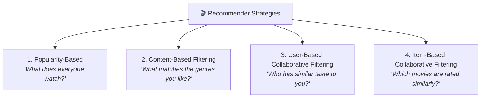

> [!NOTE] 🧭 Study Guide Overview
> This guide explains all notebooks in `/Users/nooshin/Uni/Data/data6/data6/RecommenderSystem` with **comparison tables**, **step-by-step math**, and **portfolio defense answers**:
> - **Mini Exercise 1:** [`1_Exercise_Solutions.ipynb`](file:///Users/nooshin/Uni/Data/data6/data6/RecommenderSystem/mini_exercises/1_Exercise_Solutions.ipynb) (Content-Based, User-Based CF, Item-Based CF, Precision@K, Recall@K, Average Precision).
> - **Mini Exercise 2:** [`2_Exercise_Solutions.ipynb`](file:///Users/nooshin/Uni/Data/data6/data6/RecommenderSystem/mini_exercises/2_Exercise_Solutions.ipynb) (TF-IDF Genre Encoding & Cosine Similarity).
> - **Portfolio Exercise:** [`Portfolio_Student_Solutions.ipynb`](file:///Users/nooshin/Uni/Data/data6/data6/RecommenderSystem/portfolio_exercises/Portfolio_Student_Solutions.ipynb) (MovieLens Comparison: Popularity vs. Content-Based vs. User-Based CF, Chronological Split, Rating Perturbation `5 -> 1`, and Cold-Start Scenarios).

---

# 🎯 1. Core Question: "What Exactly Are We Comparing?"

Every recommender system answers a different question using different evidence:

### 1.1. Side-by-Side Comparison of the 4 Approaches

| Strategy | Core Question | Evidence / Data Used | Biggest Strength | Biggest Weakness |
| :--- | :--- | :--- | :--- | :--- |
| **1. Popularity** | *"What is globally popular?"* | Total interaction counts (or average rating) across all users. | Works even when we know **nothing** about a new user (solves User Cold-Start). | **Zero personalization**—everyone gets the exact same mainstream blockbusters (**Popularity Bias**). |
| **2. Content-Based (CB)** | *"Which items have features matching your profile?"* | **Item metadata** (genres, tags, descriptions) + **single user's** past likes. | Can immediately recommend a **brand-new movie** with `0` ratings (solves Item Cold-Start). | **Filter Bubble / Overspecialization**—never recommends unexpected genres outside what you already watched. |
| **3. User-Based CF (UBCF)** | *"What did users similar to you enjoy?"* | The **User $\times$ Item rating matrix** (comparing rows/users). | Discovers **serendipitous / surprise** items across completely different genres. | Fails on new users or new movies with no ratings (**Cold-Start**) and struggles when matrices are sparse. |
| **4. Item-Based CF (IBCF)** | *"Which items receive similar ratings to items you liked?"* | The **User $\times$ Item rating matrix** (comparing columns/items). | Item relationships are more stable over time than human tastes; easy to explain (*"Because you watched X"*). | Still requires enough historical ratings per item (cannot recommend an item with `0` ratings). |

---

# 🧮 2. Mini Exercises 1 & 2: Step-by-Step Math & Concepts

## 2.1. Content-Based Filtering with TF-IDF (`2_Exercise (solutions).ipynb`)

When a movie has genres like `'Action|Crime|Drama'`, why use **TF-IDF** (`TfidfVectorizer`) instead of simple `0/1` binary counts?
* **Simple Answer:** If almost every movie in the database has the tag `Drama`, then two movies sharing `Drama` doesn't make them special soulmates! **TF-IDF** lowers the weight of super-common genres (like `Drama`) and boosts rare, specific genres (like `Sci-Fi` or `Animation`).

### Step-by-Step Content-Based Recommendation Pipeline:

| Step | Action | Code / Formula | Simple Meaning |
| :---: | :--- | :--- | :--- |
| **1** | **Vectorize Item Features** | `tfidf_matrix = vectorizer.fit_transform(movies['genres'])` | Turn each movie's genre list into a row of numbers (higher = rarer genre). |
| **2** | **Build User Profile** | Average the feature vectors of movies the user liked (`rating >= 4.0`). | Create a single vector summarizing the user's favorite genres. |
| **3** | **Compute Cosine Similarity** | $\cos(\theta) = \frac{\mathbf{u} \cdot \mathbf{m}}{\|\mathbf{u}\| \|\mathbf{m}\|}$ (`cosine_similarity`) | Measure the angle between the user's taste vector $\mathbf{u}$ and each unseen movie $\mathbf{m}$ (`1.0` = identical match, `0.0` = no shared genres). |

---

## 2.2. Evaluation Metrics (`1_Exercise (solutions).ipynb`)

Suppose a user actually likes **4 movies** in the test set (`Relevant Items = {M1, M3, M5, M8}`), and our recommender shows a **Top-5 list**: `[M1 ✅, M2 ❌, M3 ✅, M4 ❌, M5 ✅]`.

| Metric | Question It Answers | Formula | Step-by-Step Calculation on Our Top-5 List |
| :--- | :--- | :--- | :--- |
| **Precision@K** ($K=5$) | *"Out of the $K$ items we showed, what fraction were hits?"* | $\frac{\text{Hits in Top-}K}{K}$ | $3 \text{ hits } (\text{M1, M3, M5}) \div 5 \text{ shown} = \mathbf{0.60} \text{ (60\%)}$ |
| **Recall@K** ($K=5$) | *"Out of ALL relevant items the user likes, what fraction did we find in Top-$K$?"* | $\frac{\text{Hits in Top-}K}{\text{Total Relevant Items}}$ | $3 \text{ hits} \div 4 \text{ total relevant} = \mathbf{0.75} \text{ (75\%)}$ |
| **Average Precision (AP@5)** | *"Did we put the hits at the very top of the list (Rank 1, 2) or bury them at the bottom?"* | Average of $\text{Precision@}k$ at each rank $k$ where a hit occurs | • Hit 1 at Rank 1: $P@1 = 1/1 = 1.00$ • Hit 2 at Rank 3: $P@3 = 2/3 = 0.667$ • Hit 3 at Rank 5: $P@5 = 3/5 = 0.60$ • $\text{AP} = \frac{1.00 + 0.667 + 0.60}{3} = \mathbf{0.756}$ |

> [!TIP] 💡 Exam Tip: Why Precision@K and Recall@K Are Not Enough Alone
> **Precision@5** gives the exact same score (`1/5 = 0.20`) whether the single hit is at **Rank 1** or **Rank 5**! **Average Precision (AP)** rewards algorithms that rank relevant items higher up on the screen.

---

# 🏆 3. Portfolio Defense Guide (`Portfolio_Student_solution.ipynb`)

During your portfolio defense, you must explain how **Popularity**, **Content-Based**, and **User-Based CF** behave on the **MovieLens** dataset. Here are the exact questions and answers from the notebook:

---

## 3.1. Why Do We Use a **Chronological Split** Instead of a Random Split?

| Split Type | How It Works | Why It Matters in Real Life |
| :--- | :--- | :--- |
| **Random Split (❌ Bad for RecSys)** | Randomly picks 80% of ratings for training and 20% for testing, ignoring timestamps. | Causes **Data Leakage (Time Travel)!** The model uses movies a user watched in *2025* to "predict" what they watched in *2021*. |
| **Chronological Split (✅ Realistic)** | Sorts each user's ratings by `timestamp`: first 80% (older ratings) = **Train**, last 20% (newest ratings) = **Test**. | Matches reality: a recommender system only knows a user's **past** interactions and must predict what they will watch **next in the future**. |

---

## 3.2. Section 6 Experiment: What Happens When We Change One Rating from `5 Stars -> 1 Star`?

*(Matches [`Section6_Rating_Perturbation.png`](file:///Users/nooshin/Uni/Data/data6/data6/RecommenderSystem/portfolio_exercises/Section6_Rating_Perturbation.png))*

Suppose the target user originally gave a `5.0` rating to a movie, and we change that single rating to `1.0`:

| Method | Could Its Top-K Ranking Change? | Why? (Exact Defense Explanation) |
| :--- | :---: | :--- |
| **1. Popularity** | **❌ No** | Popularity only counts the **total number of interactions** across all users, ignoring whether the rating was 5 stars or 1 star. Also, since the user already rated that movie, it remains filtered out of their recommendations. |
| **2. Content-Based** | **✅ Yes** | The user profile is built by averaging the genres of movies the user liked (`rating >= 4.0`). Dropping this movie from `5.0` to `1.0` **removes its genres from the user's positive profile**, shifting the cosine similarity scores for all candidate movies. |
| **3. User-Based CF** | **✅ Yes** | User similarity depends on the rating differences ($|r_{u,i} - r_{v,i}|$) on co-rated movies. Changing a `5.0` to a `1.0` changes which neighbors are closest to the user, which changes the weighted average predicted ratings! |

---

## 3.3. Section 7 Difficult Situations: Scenario A — Brand-New Movie (**Item Cold-Start**)

*(Matches [`Section7_Cold_Start_Scenario.png`](file:///Users/nooshin/Uni/Data/data6/data6/RecommenderSystem/portfolio_exercises/Section7_Cold_Start_Scenario.png))*

Suppose a brand-new movie is added to the catalog today with **genres listed**, but **`0` user ratings**:

| Approach | Can It Meaningfully Recommend the New Movie Immediately? | Why? (Exact Defense Explanation) |
| :--- | :---: | :--- |
| **1. Popularity** | **❌ No** | It has `0` ratings, giving it a popularity count of `0` and placing it at the very bottom of the ranking. |
| **2. Content-Based** | **✅ Yes!** | It only needs **item metadata (genres)** to compute cosine similarity against existing user genre profiles—no ratings from other users are needed! |
| **3. User-Based CF** | **❌ No** | It requires existing ratings from neighbor users (`support >= 2`) to compute a weighted average score for an item. With `0` ratings, it can never recommend the movie. |

---

## 3.4. Difficult Situations: Scenario B — Brand-New User (**User Cold-Start**) & Feedback Loops

| Concept / Scenario | What Happens & How to Solve It |
| :--- | :--- |
| **New User with `0` Ratings (User Cold-Start)** | • **Content-Based & User-Based CF both fail** because the user has no rating history to build a genre profile or find similar neighbors. • **Popularity works immediately** as a safe fallback until the user rates a few items (or completes an onboarding taste quiz). |
| **Popularity Bias & Feedback Loops ("Rich Get Richer")** | If a platform relies heavily on Popularity or CF, popular movies get shown on the home screen $\rightarrow$ users click and rate those movies more $\rightarrow$ their interaction count grows even bigger $\rightarrow$ niche/new movies starve and never get discovered. |
