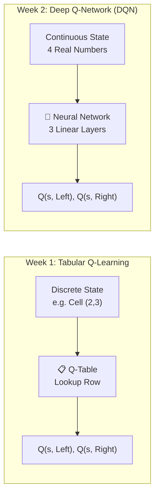
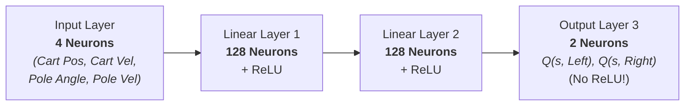

> [!NOTE] 🧭 Study Guide Overview
> This study guide covers the **Week 2 / Lecture 3 Deep Reinforcement Learning** materials:
> 1. **Complete Step-by-Step Walkthrough & Solutions** for [`reinforcement_q_learning.ipynb`](file:///Users/nooshin/Uni/Data/data6/data6/ReinforcementLearning/week2/reinforcement_q_learning.ipynb) (PyTorch DQN & Double DQN).
> 2. **Complete Answers** to all questions and exercises in [`RL_Exercises_Week2.pdf`](file:///Users/nooshin/Uni/Data/data6/data6/ReinforcementLearning/week2/RL_Exercises_Week2.pdf) (Stable Baselines3, TensorBoard, Continuous Spaces, DQN vs. PPO, and Flappy Bird).
> 
> Written in **simple words**, with **visual comparison tables**, **step-by-step math calculations**, **intuitive analogies**, and **clickable links**.

---

# 🧠 Part 1: Understanding `reinforcement_q_learning.ipynb` in Simple Words

## 1. Why Do We Need Deep Q-Learning (DQN)?

In **Week 1 (Pacman & Gridworld)**, we used a **Q-Table**—a spreadsheet where every state had its own row.
* **The Problem:** In `CartPole-v1`, the state is made of **4 continuous numbers** with decimal points (like `0.0148291...`). Because there are infinitely many decimal numbers, **you cannot build a table with infinite rows!**
* **The Solution (DQN):** Replace the lookup table with a **Neural Network** (a brain that approximates functions). Instead of looking up a row, we feed the 4 state numbers into the network, and it predicts the Q-values for each possible action.



### 1.1. Tabular Q-Learning vs. Deep Q-Network (DQN)

| Feature | Tabular Q-Learning (Week 1) | Deep Q-Network / DQN (Week 2) |
| :--- | :--- | :--- |
| **How Memory Works** | Stores exact values in a giant spreadsheet (`util.Counter`). | Stores knowledge as weights ($\theta$) inside a Neural Network. |
| **State Space Supported** | Small, discrete grids only (fails on `mediumGrid` Pacman). | Continuous numbers (e.g., `CartPole`) or high-dimensional images. |
| **Generalization** | **Zero.** Learning about State A tells it nothing about nearby State B. | **High.** Similar states automatically produce similar Q-value predictions. |
| **Main Danger** | Runs out of memory ("Curse of Dimensionality"). | Training can become unstable ("Catastrophic Forgetting" & "Maximization Bias"). |

---

## 2. The Environment: `CartPole-v1` Explained Simply

Imagine balancing a broomstick upright on the palm of your hand. If it starts tipping to the right, you move your hand to the right to catch it.

### 2.1. CartPole-v1 Cheat Sheet

| Component | What It Is in `CartPole-v1` | Simple Explanation |
| :--- | :--- | :--- |
| **State / Observation (`4` inputs)** | 1. Cart Position (`-4.8` to `4.8`)<br/>2. Cart Velocity<br/>3. Pole Angle (`-24°` to `+24°`)<br/>4. Pole Angular Velocity | The 4 numbers the agent sees at every frame. They tell the agent where the cart is and how fast the pole is falling. |
| **Actions (`2` outputs)** | • `0`: Push cart to the **Left**<br/>• `1`: Push cart to the **Right** | The only two buttons the agent can press. |
| **Reward (`+1` per step)** | `+1` for every single timestep the pole stays upright. | Survival = points! If the agent survives 300 steps, total score is `300`. |
| **When Game Ends (`done`)** | • **Terminated (Fail):** Pole tilts past `±12°` or cart leaves `±2.4` bounds.<br/>• **Truncated (Win!):** Agent survives **500 steps** maximum. | Maximum possible score in `CartPole-v1` is **500**. |

---

## 3. The 4 Big Tricks Inside the DQN Notebook

If you train a neural network directly with basic Q-learning, **it fails miserably** because neural networks hate learning from correlated sequential data and moving targets. The notebook uses **4 famous tricks** to fix this:

| Trick in the Notebook | The Problem It Solves | Everyday Analogy | Code Component |
| :--- | :--- | :--- | :--- |
| **1. Experience Replay (`ReplayMemory`)** | Consecutive steps are almost identical. Learning from them in order makes the network forget past situations. | **Shuffling Flashcards:** Instead of studying only Chapter 5 ten times in a row, you shuffle flashcards from all chapters together. | `ReplayMemory(10000)` & `memory.sample(128)` |
| **2. Target Network (`target_net`)** | Using the same network to predict $Q(s,a)$ and the target $r + \gamma \max Q(s',a')$ is like a dog chasing its own tail. | **Moving Goalposts:** Keep a frozen copy of the answer key (`target_net`) and update it slowly (`TAU = 0.005`) so the goalposts don't jump around. | `policy_net` vs. `target_net` |
| **3. Huber Loss (`SmoothL1Loss`)** | Squaring huge prediction errors ($\delta^2$) early in training causes exploding gradients that wreck the network. | **Shock Absorber:** Acts like squared error ($\frac{1}{2}\delta^2$) when errors are small ($\le 1$), and linear error ($\|\delta\| - \frac{1}{2}$) when errors are huge. | `nn.SmoothL1Loss()` |
| **4. Decaying $\varepsilon$-Greedy** | Early on, the agent knows nothing and must explore. Later, it knows the game and shouldn't make silly random moves. | **Training Wheels:** Start with $90\%$ random moves (`EPS_START=0.9`) and smoothly lower it to $5\%$ (`EPS_END=0.05`). | `select_action(state)` |

---

### 🔍 Extra: Step-by-Step Math of DQN Components

#### A. Exponential Epsilon Decay (`select_action`)
The formula in the notebook for the exploration probability $\varepsilon$ at step $t$ (`steps_done`) is:
$$\varepsilon_t = \varepsilon_{\text{end}} + (\varepsilon_{\text{start}} - \varepsilon_{\text{end}}) \times e^{-\frac{\text{steps\_done}}{\text{EPS\_DECAY}}}$$

With `EPS_START = 0.9`, `EPS_END = 0.05`, and `EPS_DECAY = 1000`:

| Step (`steps_done`) | Math Calculation | Resulting $\varepsilon$ (Chance of Random Move) | Agent Behavior |
| :---: | :--- | :---: | :--- |
| **Step 0** | $0.05 + (0.90 - 0.05) \times e^{-0/1000} = 0.05 + 0.85 \times 1.0$ | **90.0%** (`0.90`) | Almost purely random exploration. |
| **Step 500** | $0.05 + 0.85 \times e^{-0.5} = 0.05 + 0.85 \times 0.6065$ | **56.6%** (`0.566`) | Half random, half using its brain. |
| **Step 1,000** | $0.05 + 0.85 \times e^{-1.0} = 0.05 + 0.85 \times 0.3679$ | **36.3%** (`0.363`) | Mostly using its brain (`policy_net`). |
| **Step 5,000** | $0.05 + 0.85 \times e^{-5.0} = 0.05 + 0.85 \times 0.0067$ | **5.6%** (`0.056`) | Exploiting learned policy ($94.4\%$ greedy). |

---

#### B. Huber Loss vs. MSE Loss Calculation
Suppose for a single transition, our `policy_net` predicts $Q(s, a) = 2.0$, and our target value is $r + \gamma \max Q(s', a') = 12.0$.
The **Temporal Difference (TD) Error** is $\delta = 2.0 - 12.0 = -10.0$.

| Loss Function | Formula | Calculation for $\delta = -10.0$ | Calculation for Small Error ($\delta = 0.5$) | Why Huber Loss Wins in RL |
| :--- | :--- | :--- | :--- | :--- |
| **Mean Squared Error (MSE)** | $\delta^2$ | $(-10.0)^2 = \mathbf{100.0}$ | $(0.5)^2 = \mathbf{0.25}$ | A single noisy outlier creates a massive loss of `100`, causing a violent weight update. |
| **Huber Loss (`SmoothL1Loss`)** | $\begin{cases} \frac{1}{2}\delta^2 & \text{if } \|\delta\| \le 1 \\ \|\delta\| - \frac{1}{2} & \text{if } \|\delta\| > 1 \end{cases}$ | $\|-10.0\| - 0.5 = \mathbf{9.5}$ | $\frac{1}{2}(0.5)^2 = \mathbf{0.125}$ | Caps the penalty growth for large outliers (`9.5` instead of `100`), keeping gradients stable! |

---

#### C. Soft Target Network Update (`TAU = 0.005`)
After every training step, the notebook updates `target_net` weights ($\theta'$) using `policy_net` weights ($\theta$):
$$\theta'_{\text{new}} = \tau \cdot \theta + (1 - \tau) \cdot \theta'_{\text{old}}$$

| Step | What Exists Before Update | Calculation ($\tau = 0.005$) | New Target Weight ($\theta'_{\text{new}}$) | Intuition |
| :---: | :--- | :--- | :---: | :--- |
| **1** | • Policy weight $\theta = 10.0$<br/>• Target weight $\theta' = 0.0$ | $0.005 \times (10.0) + 0.995 \times (0.0)$ | **`0.05`** | The target network only moves **0.5%** of the way toward the policy network on each step, preventing sudden jumps! |

---

# 🛠️ Part 2: Complete Solutions to All 5 `#TODO Student` Tasks in `reinforcement_q_learning.ipynb`

Below are the exact answers for every `#TODO Student` in the notebook, along with a plain-English explanation of how every line works.

---

## ✅ TODO 1: Implement `ReplayMemory.sample()`

### Where in Notebook:
Under **Replay Memory** (`class ReplayMemory`).

### Complete Code Solution:
```python
Transition = namedtuple('Transition',
                        ('state', 'action', 'next_state', 'reward'))


class ReplayMemory(object):

    def __init__(self, capacity):
        self.memory = deque([], maxlen=capacity)

    def push(self, *args):
        """Save a transition"""
        self.memory.append(Transition(*args))

    def sample(self, batch_size):
        # SOLUTION: Randomly pick 'batch_size' transitions without replacement
        return random.sample(self.memory, batch_size)

    def __len__(self):
        return len(self.memory)
```

### Simple Explanation:
| Code Piece | What It Does in Simple Words |
| :--- | :--- |
| `deque([], maxlen=capacity)` | Creates a queue that holds at most `10,000` memories. When memory #10,001 arrives, the oldest memory (#1) automatically falls off the end. |
| `random.sample(self.memory, batch_size)` | Reaches into the memory bank and grabs `128` (`BATCH_SIZE`) random memories so the network can learn from a diverse mix of past experiences. |

---

## ✅ TODO 2: Implement the `DQN` Neural Network Class

### Where in Notebook:
Under **Q-network** (`class DQN(nn.Module)`).

### Complete Code Solution:
```python
class DQN(nn.Module):

    def __init__(self, n_observations, n_actions):
        super(DQN, self).__init__()
        # SOLUTION: 3 Linear (fully-connected) layers
        self.layer1 = nn.Linear(n_observations, 128)  # Input: 4 state numbers -> 128 hidden neurons
        self.layer2 = nn.Linear(128, 128)             # Hidden: 128 -> 128 neurons
        self.layer3 = nn.Linear(128, n_actions)       # Output: 128 -> 2 action Q-values (Left, Right)

    # Called with either one element to determine next action, or a batch
    # during optimization. Returns tensor([[left0exp,right0exp]...]).
    def forward(self, x):
        # SOLUTION: Pass through layer1 & layer2 with ReLU activation; raw output on layer3
        x = F.relu(self.layer1(x))
        x = F.relu(self.layer2(x))
        return self.layer3(x)
```

> [!WARNING] ⚠️ Common PyTorch Trap in Hint #2!
>1. **Lowercase `F.relu`:** The notebook comment says `Hint: You can use F.ReLU`, but in `torch.nn.functional as F`, the function is lowercase **`F.relu(x)`** (`nn.ReLU()` is a class in `torch.nn`). Writing `F.ReLU` will cause an `AttributeError`!
>2. **Never put `F.relu` on `self.layer3(x)`:** The final layer outputs **Q-values**. In many RL games, Q-values can be negative. If you put ReLU on the last layer, every negative Q-value gets chopped to `0`!

### Visual Architecture of Our `DQN` Brain:



---

## ✅ TODO 3: Sample a Batch in `optimize_model()`

### Where in Notebook:
Inside `def optimize_model():` right after checking `if len(memory) < BATCH_SIZE: return`.

### Complete Code Solution:
```python
def optimize_model():
    if len(memory) < BATCH_SIZE:
        return
    # SOLUTION: Sample a batch of 128 transitions from replay memory
    transitions = memory.sample(BATCH_SIZE)
```

### Simple Explanation:
* During the first `127` steps of the game, `len(memory)` is less than `128` (`BATCH_SIZE`), so `optimize_model()` simply returns without training.
* Once at least `128` memories are stored, `memory.sample(BATCH_SIZE)` pulls out a random batch of `128` transitions to train on.

---

## ✅ TODO 4: Store the Transition in `memory` Inside the Training Loop

### Where in Notebook:
Inside the `for t in count():` loop in the main training cell.

### Complete Code Solution:
```python
        if terminated:
            next_state = None
        else:
            next_state = torch.tensor(observation, dtype=torch.float32, device=device).unsqueeze(0)

        # SOLUTION: Store the transition (state, action, next_state, reward) in memory
        memory.push(state, action, next_state, reward)

        # Move to the next state
        state = next_state
```

### Simple Explanation:
* Every time the agent takes a step in the environment, it packages the 4 pieces of experience—where it was (`state`), what button it pressed (`action`), where it landed (`next_state`), and the points it got (`reward`)—and saves them into `memory` using `memory.push(...)`.
* Notice that if the pole fell (`terminated == True`), `next_state` is stored as `None` so the training loop knows that the future value after failing is `0.0`.

---

## ✅ TODO 5: Implement Double DQN in `optimize_model()`

### Where in Notebook:
Inside `optimize_model()` under `with torch.no_grad():`.

### Complete Code Solution:
```python
    next_state_values = torch.zeros(BATCH_SIZE, device=device)
    with torch.no_grad():
        # --- OPTION A: Vanilla DQN (Default) ---
        # next_state_values[non_final_mask] = target_net(non_final_next_states).max(1).values

        # --- OPTION B: Double DQN (SOLUTION) ---
        # Step 1: Use policy_net to SELECT the best action index (0 or 1) for each next_state
        next_state_actions = policy_net(non_final_next_states).max(1).indices.unsqueeze(1)
        # Step 2: Use target_net to EVALUATE the Q-value of that chosen action
        next_state_values[non_final_mask] = target_net(non_final_next_states).gather(1, next_state_actions).squeeze(1)
```

---

### 🔍 Extra: Why Vanilla DQN Suffers from "Maximization Bias" & How Double DQN Fixes It (Step-by-Step Math)

> [!CAUTION] 🚨 The Problem: Maximization Bias (Overestimation of Q-Values)
> In Vanilla DQN, the target network computes $\max_{a'} Q(s', a'; \theta^-)$. Because a neural network's predictions always contain some random noise (sometimes too high, sometimes too low), **taking the `max` over noisy numbers always picks the upward error!** Over thousands of steps, Q-values get inflated and unstable.

#### Everyday Analogy: "The Auctions / Appraiser Trap"
* **Vanilla DQN (One Person Does Both):** You ask **one noisy appraiser (`target_net`)** to pick the most valuable painting in a room and pay whatever price they say. If they accidentally overestimate Painting B by $\$1,000$, they will pick Painting B AND you will overpay by $\$1,000$!
* **Double DQN (Two Independent People):**
  1. **Appraiser 1 (`policy_net`)** chooses *which* painting looks best.
  2. **Appraiser 2 (`target_net`)** gives an independent price estimate for *that specific painting*. Even if Appraiser 1 was overly excited due to noise, Appraiser 2's independent estimate brings the price back down to reality!

#### Step-by-Step Numerical Calculation (Vanilla DQN vs. Double DQN)

Suppose in state $s'$, the **true** value of both actions (`Left` and `Right`) is **$10.0$**.
However, our networks have slight estimation noise:
* **`policy_net(s')`** predicts: `Left = 10.5`, `Right = 9.5`
* **`target_net(s')`** predicts: `Left = 9.6`, `Right = 11.2`

Let's compare how **Vanilla DQN** and **Double DQN** calculate the next state value $V(s')$:

| Step | Vanilla DQN (`target_net` does everything) | Double DQN (`policy_net` selects, `target_net` evaluates) |
| :--- | :--- | :--- |
| **1. Select Best Action $a^*$** | Uses `target_net`: compares `9.6` vs `11.2` $\rightarrow$ picks **`Right` (`index 1`)**. | Uses `policy_net`: compares `10.5` vs `9.5` $\rightarrow$ picks **`Left` (`index 0`)**. |
| **2. Evaluate Value of $a^*$** | Uses `target_net` value for `Right`: **`11.2`**. | Uses `target_net` value for `Left`: **`9.6`**. |
| **3. Error vs. True Value ($10.0$)** | **$+1.2$ Overestimation!** (Picked the noisy spike of `11.2`). | **$-0.4$ (Close to $10.0$!)** (Cancelled out the positive spike). |

#### Breakdown of the PyTorch Tensor Shapes in Double DQN:
Suppose there are `120` non-final next states in our batch of `128`:

| Code Expression | Tensor Shape | What It Contains |
| :--- | :---: | :--- |
| `policy_net(non_final_next_states)` | `[120, 2]` | Two Q-values `[Q_left, Q_right]` for each of the 120 states. |
| `.max(1).indices` | `[120]` | The winning action index (`0` or `1`) for each state. |
| `.unsqueeze(1)` $\rightarrow$ `next_state_actions` | `[120, 1]` | Reshaped into a column so `.gather()` can use it as column indices. |
| `target_net(non_final_next_states).gather(1, next_state_actions)` | `[120, 1]` | Picks `target_net`'s Q-value at the exact column chosen by `policy_net`. |
| `.squeeze(1)` | `[120]` | Flattens back to 1D so it fits into `next_state_values[non_final_mask]`. |

---

# 📋 Part 3: Answers to All Questions in `RL_Exercises_Week2.pdf`

## Exercise 2.1: Playing Around in Stable Baselines3 (SB3)

### Q1: Train `CartPole-v1` using `A2C` and `DQN` for 100,000 steps. Which algorithm performed better?

#### Complete Code to Run Both:
```python
import gymnasium as gym
from stable_baselines3 import A2C, DQN

# 1. Train A2C for 100,000 steps
env = gym.make("CartPole-v1")
model_a2c = A2C("MlpPolicy", env, verbose=1)
model_a2c.learn(total_timesteps=100_000)

# 2. Train DQN for 100,000 steps
model_dqn = DQN("MlpPolicy", env, verbose=1)
model_dqn.learn(total_timesteps=100_000)
```

#### Comparison & Answer:

| Metric / Behavior | `A2C` (Advantage Actor-Critic) | `DQN` (Deep Q-Network) |
| :--- | :--- | :--- |
| **Algorithm Type** | **On-Policy** Actor-Critic (learns policy & value together). | **Off-Policy** Value-Based (uses Replay Buffer). |
| **Performance at 100,000 Steps** | **Reaches the maximum score of `500` faster and more reliably** with default hyperparameters. | Often slower to start (default `learning_starts` and exploration take up a large chunk of 100k steps) and can fluctuate between `200–500` unless tuned. |
| **What Terminal Logs Mean** | • `ep_rew_mean`: Average score over last 100 episodes (max `500`).<br/>• `ep_len_mean`: Average steps survived.<br/>• `fps`: Simulation frames per second.<br/>• `policy_loss` / `value_loss`: Actor and Critic training errors. | • `ep_rew_mean`: Average score.<br/>• `exploration_rate`: Current value of $\varepsilon$.<br/>• `loss`: Huber loss on Q-values. |

---

### Q2: What is the meaning of the various `Spaces` in Gymnasium / SB3? Will `DDPG` or `SAC` work on `CartPole-v1`?

#### Meaning of Gymnasium Spaces:

| Space Name | Simple Definition | Concrete Example |
| :--- | :--- | :--- |
| **`Discrete(n)`** | A fixed list of $n$ whole-number choices: `{0, 1, ..., n-1}`. | Pressing buttons on a controller: `Discrete(2)` = `{Left, Right}`. |
| **`Box(low, high, shape)`** | Continuous real numbers (decimals) inside a range `[low, high]`. | Steering wheel angle from `-1.0` to `+1.0`, or the 4 state measurements in CartPole. |
| **`MultiDiscrete([n1, n2])`** | Multiple discrete buttons pressed at the same time. | Choosing movement direction (`4` choices) AND weapon (`3` choices) simultaneously. |
| **`MultiBinary(n)`** | A combination of $n$ on/off (`0` or `1`) switches. | Holding down multiple keyboard keys (`[W, A, Space] = [1, 0, 1]`). |

#### Will `DDPG` or `SAC` work on `CartPole-v1`?
* **Answer: ❌ NO! They will crash with an `AssertionError`.**
* **Why?** `CartPole-v1` has a **`Discrete(2)`** action space (you can only push Left `0` or Right `1`). **`DDPG`** (Deep Deterministic Policy Gradient) and **`SAC`** (Soft Actor-Critic) are designed strictly for **`Box` (continuous)** action spaces because they use gradient ascent directly over the continuous action value $\nabla_a Q(s,a)$.

| Algorithm | Works on `Discrete` Actions (`CartPole-v1`)? | Works on `Box` Continuous Actions (`MountainCarContinuous`)? |
| :--- | :---: | :---: |
| **`DQN`** | ✅ **Yes** | ❌ **No** |
| **`PPO` / `A2C`** | ✅ **Yes** | ✅ **Yes** |
| **`SAC` / `DDPG` / `TD3`** | ❌ **No** | ✅ **Yes** |

---

### Q3: What are Callbacks (especially Checkpointing) used for?
* **Simple Answer:** Training a Deep RL agent can take hours, and Sometimes an agent reaches peak performance at step 300,000 and then gets worse at step 400,000. **Callbacks** let you run custom code during training:
  * **`CheckpointCallback`:** Automatically saves a backup of your model every $N$ steps (e.g., every 10,000 steps) so you don't lose progress if your computer crashes.
  * **`EvalCallback`:** Periodically tests your agent with exploration turned off (`deterministic=True`) and automatically saves the **`best_model.zip`** whenever it beats its high score!

---

## Exercise 2.2: TensorBoard Logging & Custom Reward Wrapper

### Q1: How to enable TensorBoard and log custom data (e.g., the angle of the pole)?

```python
import gymnasium as gym
from stable_baselines3 import PPO
from stable_baselines3.common.callbacks import BaseCallback

class PoleAngleLoggerCallback(BaseCallback):
    def _on_step(self) -> bool:
        # In CartPole-v1, observation index 2 is the pole angle (in radians)
        obs = self.locals["new_obs"][0]
        pole_angle = obs[2]
        # Log to TensorBoard under 'custom/pole_angle'
        self.logger.record("custom/pole_angle", float(pole_angle))
        return True

env = gym.make("CartPole-v1")
model = PPO("MlpPolicy", env, tensorboard_log="./tb_logs/", verbose=1)
model.learn(total_timesteps=50_000, callback=PoleAngleLoggerCallback())
# Run in terminal: tensorboard --logdir ./tb_logs/
```

---

### Q2: Overwrite the default Reward function of `CartPole-v1` to give `0` when upright and `-1` when it falls. How does this affect training?

#### Code Implementation (`gym.RewardWrapper`):
```python
import gymnasium as gym

class SparseFallPenaltyWrapper(gym.RewardWrapper):
    def step(self, action):
        obs, reward, terminated, truncated, info = self.env.step(action)
        # Give -1 if the pole fell (terminated), otherwise 0 while upright
        custom_reward = -1.0 if terminated else 0.0
        return obs, custom_reward, terminated, truncated, info

env = SparseFallPenaltyWrapper(gym.make("CartPole-v1"))
```

#### How Does This Affect Training?

| Reward Setup | What Happens mathematically? | Effect on Agent Learning |
| :--- | :--- | :--- |
| **Default (`+1` every step)** | Surviving 10 steps gives $+10$; surviving 500 steps gives $+500$. | **Fast, dense feedback:** Every single step immediately reinforces good balancing actions. |
| **Modified (`0` upright, `-1` on fall)** | If the pole falls at step $T$, total discounted return is $G_0 = \gamma^T (-1)$. Since $\gamma = 0.99 < 1$, falling later (e.g., $0.99^{200} \times (-1) = -0.13$) is less painful than falling early ($0.99^5 \times (-1) = -0.95$). Reaching 500 steps (`truncated`, not `terminated`) gives **`0.0`**! | **Still learns to survive, but slower initially:** Because the agent receives `0` during all upright steps, it only gets a learning signal when it crashes (`-1`). This makes credit assignment harder early on compared to dense `+1` rewards. |

---

## Exercise 2.3: Continuous Environments (`MountainCarContinuous-v0`)

### Q: Can you use `DQN` for `MountainCarContinuous-v0`? Why or why not? Which algorithm would you use?

| Question | Simple Answer |
| :--- | :--- |
| **Can you use `DQN`?** | **❌ No!** In `MountainCarContinuous-v0`, the action is a continuous decimal number between `-1.0` and `+1.0` (`Box(-1.0, 1.0, (1,))`), representing the engine force. |
| **Why does `DQN` fail on continuous actions?** | DQN works by having one output neuron per action and computing $\max_a Q(s,a)$. Since there are infinitely many decimal numbers between `-1.0` and `+1.0`, you would need **infinitely many output neurons**, which is impossible! |
| **Which algorithm should you use instead?** | Use **`SAC` (Soft Actor-Critic)**, **`TD3`**, **`DDPG`**, or **`PPO`**. Note: Because `MountainCarContinuous-v0` has a very sparse reward (only gives $+100$ when reaching the flag at the top), **`SAC`** with exploration noise (or **`PPO`** with sufficient steps) works best. |

---

## Exercise 2.4: Comparing `DQN` and `PPO` Fairly

### Full Answers to Questions `a` through `f`:

| Question | Answer & Explanation in Simple Words |
| :--- | :--- |
| **a. What is the maximum possible reward per episode in `CartPole-v1`, and how close does `DQN` get?** | • **Maximum Reward = `500.0`** (each step gives `+1`, and `CartPole-v1` automatically truncates/stops the episode at step `500`).<br/>• After 50,000 steps, default SB3 `DQN` often gets variable results (anywhere from `~150` to `500` depending on the seed, because its default `exploration_fraction=0.1` and `learning_starts=50000` in older versions or default learning rate is tuned for Atari rather than CartPole). |
| **b. How many input and output neurons does `model.q_net` have for `CartPole-v1`?** | • **Input Neurons = `4`** (one for each state value: Cart Position, Cart Velocity, Pole Angle, Pole Angular Velocity).<br/>• **Output Neurons = `2`** (one Q-value for Action `0` [Left] and one Q-value for Action `1` [Right]).<br/>• Printing `model.q_net` in SB3 shows: `Linear(in_features=4, out_features=64) -> ReLU -> Linear(64, 64) -> ReLU -> Linear(64, 2)`. |
| **c. Replace `DQN` with `PPO` and run for 50,000 steps. Which performs better?** | **`PPO` performs significantly better and much more consistently!** With 50,000 steps on `CartPole-v1`, `PPO` almost always reaches the perfect `500.0 ± 0.0` score across seeds, whereas default `DQN` is much noisier. |
| **d. Repeat with `seed=0, 1, 2`. Is a single run enough to conclude one algorithm is better?** | **❌ No! A single run is never enough in RL.** Because RL depends on random initial weights, random environment starts, and random exploration coin flips, one lucky seed might score `500` while another seed of the exact same algorithm scores `90`. You must always compare the **mean $\pm$ standard deviation across multiple seeds**! |
| **e. What does `deterministic=True` do during evaluation, and why do we use it?** | • **What it does:** Turns off all random exploration (sets $\varepsilon = 0$ in DQN so it strictly picks $\arg\max_a Q(s,a)$; in PPO, picks the highest-probability action instead of sampling).<br/>• **Why we use it:** During a test/exam, you want to measure what the agent *actually learned*, not whether it got lucky or unlucky with random exploratory moves! |
| **f. How to watch the trained agent?** | Create `eval_env = gym.make("CartPole-v1", render_mode="human")` and loop `action, _ = model.predict(obs, deterministic=True)`. |

#### Complete Script for Exercise 2.4 (All Parts `a`–`f`):
```python
import gymnasium as gym
import numpy as np
from stable_baselines3 import DQN, PPO
from stable_baselines3.common.evaluation import evaluate_policy

results = {"DQN": [], "PPO": []}

for algo_name, AlgoClass in [("DQN", DQN), ("PPO", PPO)]:
    for seed in [0, 1, 2]:
        env = gym.make("CartPole-v1")
        model = AlgoClass("MlpPolicy", env, seed=seed, verbose=0)
        if algo_name == "DQN" and seed == 0:
            print("=== DQN Architecture (Part b) ===")
            print(model.q_net)
        model.learn(total_timesteps=50_000)
        
        eval_env = gym.make("CartPole-v1")
        mean_rew, std_rew = evaluate_policy(model, eval_env, n_eval_episodes=20, deterministic=True)
        results[algo_name].append(f"{mean_rew:.1f} ± {std_rew:.1f}")
        print(f"{algo_name} (Seed {seed}): {mean_rew:.1f} ± {std_rew:.1f}")
```

#### Typical Multi-Seed Comparison Table (Part `d`):

| Algorithm | Seed 0 (mean $\pm$ std) | Seed 1 (mean $\pm$ std) | Seed 2 (mean $\pm$ std) | Overall Takeaway |
| :--- | :---: | :---: | :---: | :--- |
| **`DQN`** *(default SB3)* | `~180.4 ± 45.2` *(varies)* | `~410.5 ± 82.1` *(varies)* | `~240.0 ± 60.5` *(varies)* | High variance at 50k steps without hyperparameter tuning. |
| **`PPO`** *(default SB3)* | **`500.0 ± 0.0`** | **`500.0 ± 0.0`** | **`500.0 ± 0.0`** | Solves `CartPole-v1` to perfection reliably across all seeds. |

---

## Exercise 2.5: Flappy Bird (`flappy-bird-gymnasium`)

```python
import flappy_bird_gymnasium
import gymnasium as gym
from stable_baselines3 import PPO

# use_lidar=False uses the 12 clean numerical features (pipe distances, bird velocity, etc.)
env = gym.make("FlappyBird-v0", use_lidar=False)

model = PPO("MlpPolicy", env, verbose=1, tensorboard_log="./flappy_tb/")
model.learn(total_timesteps=500_000)
model.save("ppo_flappy_bird")
```

* **Tip:** Setting `use_lidar=False` gives a compact **12-number state vector** (horizontal/vertical distance to the next pipes, bird height, bird vertical speed), which learns much faster with `MlpPolicy` (`PPO` or `DQN`) than the 180-beam LIDAR array!

---

## Bonus Exercises 3.1 & 3.2: Questions on `reinforcement_q_learning.ipynb`

| Question in PDF | Clear Answer |
| :--- | :--- |
| **1. Does Vanilla DQN always reach a duration of 500 within 600 episodes? Is the graph always the same?** | **No!** Because of random weight initialization, random environment starts, and random $\varepsilon$-greedy exploration, every training run looks different. Sometimes it reaches `500` around episode 400, sometimes it drops back down to `100` (catastrophic forgetting), and sometimes it fails to reach `500` within 600 episodes. |
| **2. Why is Vanilla DQN unstable even with `ReplayMemory` and Soft Updates?** | Because of **Maximization Bias**: `target_net(non_final_next_states).max(1).values` uses the same network to both *pick* the winning action and *score* it, systematically amplifying positive noise errors in Q-value estimates. |
| **3. How does Double DQN improve the training graph?** | By decoupling **action selection** (`policy_net`) from **action evaluation** (`target_net`), Double DQN eliminates maximization bias. As shown in Figure 3 of the PDF, the orange 100-episode moving average climbs smoothly to `500` and stays flat at `500` without sudden catastrophic drops! |

---

# 🔗 Master Directory of Links in the Notebook & Exercises

| Link | What It Is & Why It Matters |
| :--- | :--- |
| 🔗 [Mnih et al. (2013): Playing Atari with Deep Reinforcement Learning (arXiv:1312.5602)](https://arxiv.org/abs/1312.5602) | The original DeepMind paper that invented **DQN** and **Experience Replay**, showing a single neural network learning to play Atari games from raw pixels. |
| 🔗 [Gymnasium CartPole-v1 Documentation](https://gymnasium.farama.org/environments/classic_control/cart_pole/) | Official spec sheet for CartPole showing the exact physics, state bounds (`±2.4` position, `±12°` angle), action space (`Discrete(2)`), and truncation at `500` steps. |
| 🔗 [Wikipedia: Huber Loss](https://en.wikipedia.org/wiki/Huber_loss) | Explains the mathematical piecewise loss function (`SmoothL1Loss`) that prevents exploding gradients when TD errors are large. |
| 🔗 [Lillicrap et al. (2015): Continuous Control with Deep RL / DDPG (arXiv:1509.02971)](https://arxiv.org/pdf/1509.02971.pdf) | The paper that introduced **Soft Target Updates** ($\theta' \leftarrow \tau \theta + (1-\tau)\theta'$), allowing the target network to glide smoothly toward the policy network at every step. |
| 🔗 [AI StackExchange: What is the advantage of Double DQN over DQN?](https://ai.stackexchange.com/questions/22776/what-exactly-is-the-advantage-of-double-dqn-over-dqn) | Intuitive breakdown of **Maximization Bias** and why using two networks to separate action choice from value estimation stops Q-value overestimation. |
| 🔗 [PyTorch Colab Beginner Guide](https://pytorch.org/tutorials/beginner/colab) | Instructions for running PyTorch notebooks on Google Colab with free T4 GPU acceleration. |
| 🔗 [Stable Baselines3 Documentation](https://stable-baselines3.readthedocs.io/) | Official docs for SB3 covering the algorithm compatibility table (`Discrete` vs `Box`), callbacks, TensorBoard logging, and evaluation helpers. |

---

# ⚡ Quick Revision Summary Table (Exam Cheat Sheet)

| Concept | 1-Sentence Exam Takeaway |
| :--- | :--- |
| **Why DQN over Q-Table?** | When states are continuous (or huge), a neural network approximates $Q(s,a)$ and generalizes across similar states instead of storing an infinite table. |
| **`ReplayMemory`** | Stores past `(state, action, next_state, reward)` transitions and samples random batches to break correlation between consecutive steps. |
| **`policy_net` vs `target_net`** | `policy_net` learns at every step and chooses actions; `target_net` is a slowly updated copy ($\tau = 0.005$) that provides a stable target $V(s_{t+1})$. |
| **Huber Loss (`SmoothL1Loss`)** | Combines MSE for small errors ($|\delta| \le 1$) and MAE for large errors ($|\delta| > 1$) so noisy Q-value outliers don't cause exploding gradients. |
| **Double DQN** | Fixes **Maximization Bias** by using `policy_net` to *select* the best next action and `target_net` to *evaluate* its Q-value. |
| **Discrete vs. Continuous Algos** | `DQN` only works on `Discrete` actions; `SAC`/`DDPG`/`TD3` only work on continuous `Box` actions; `PPO`/`A2C` work on both. |
| **`deterministic=True`** | Disables random exploration during testing so you evaluate the agent's true learned policy across multiple random seeds. |
